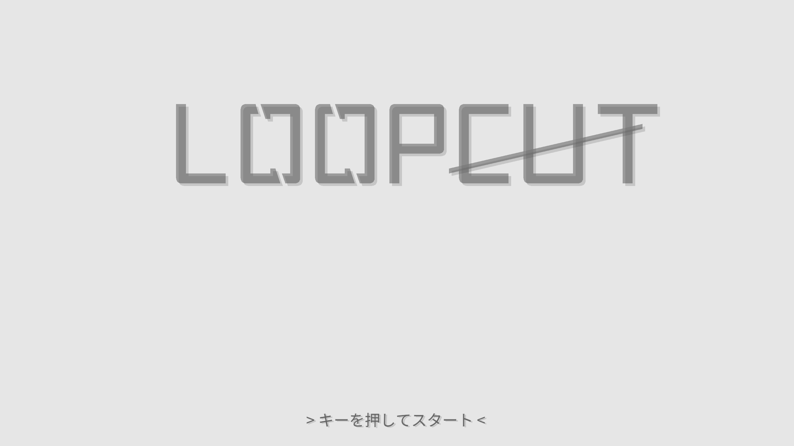
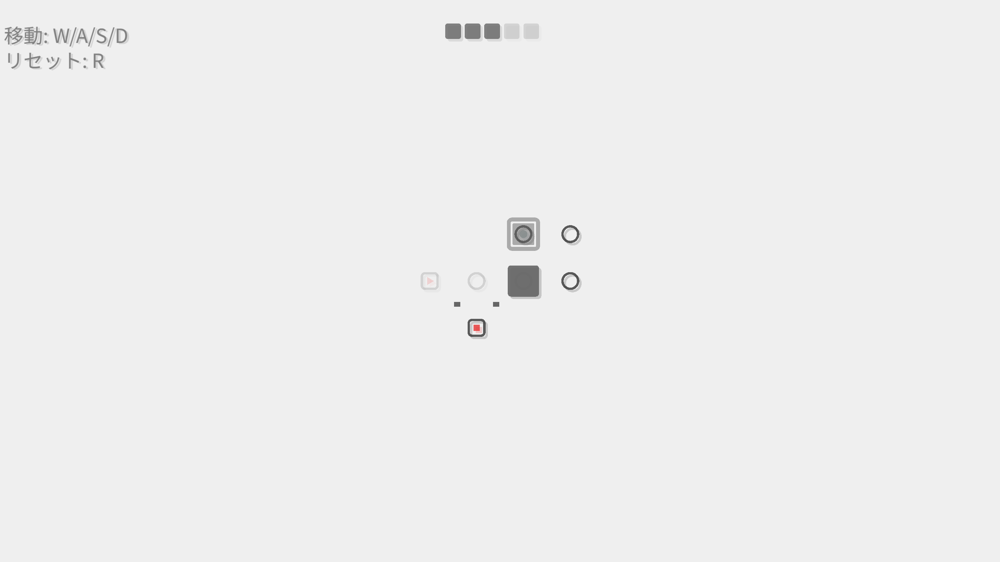
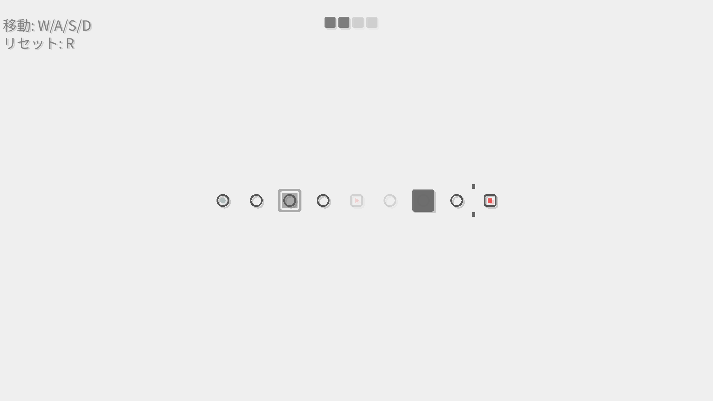

# LoopCut

-_永久にループする空間。あなたはこのループを断ち切ることができるのか_-

## ゴーストを駆使して進め

ループする空間にいるのはあなただけではありません。\
時に実体を持ち、時に実体のないゴーストを導き脱出への足掛かりへとしましょう。

## プレイ時の注意
- このゲームはキーボードを操作に使用します。キーボードのある環境でプレイしてください。
- 進捗はブラウザに自動保存されます。
- 制作者は355mlのエナドリを服用して15時間コードを書き続けたため、わかりにくい動作やバグがあるかもしれません。もし発見した場合は見なかったことにしてください。

[プレイはこちら](https://asynchronous-0x4c.github.io/LoopCut/)

