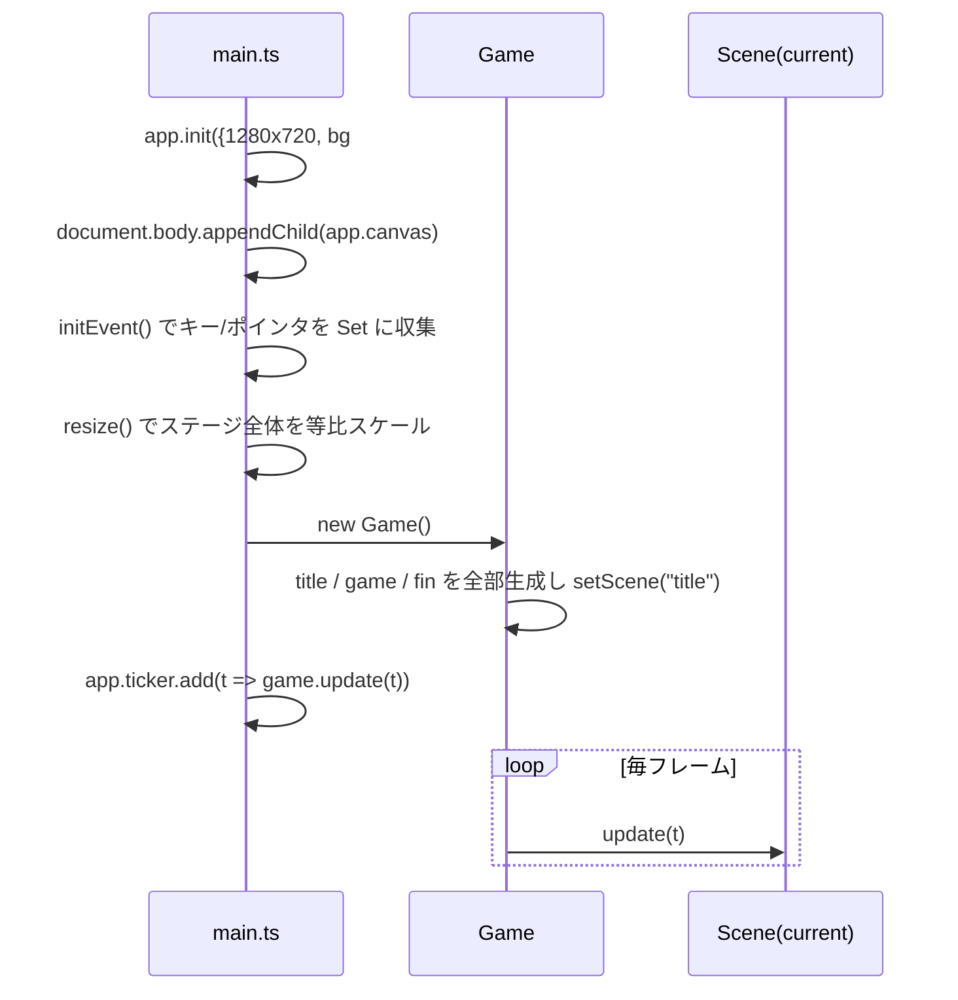
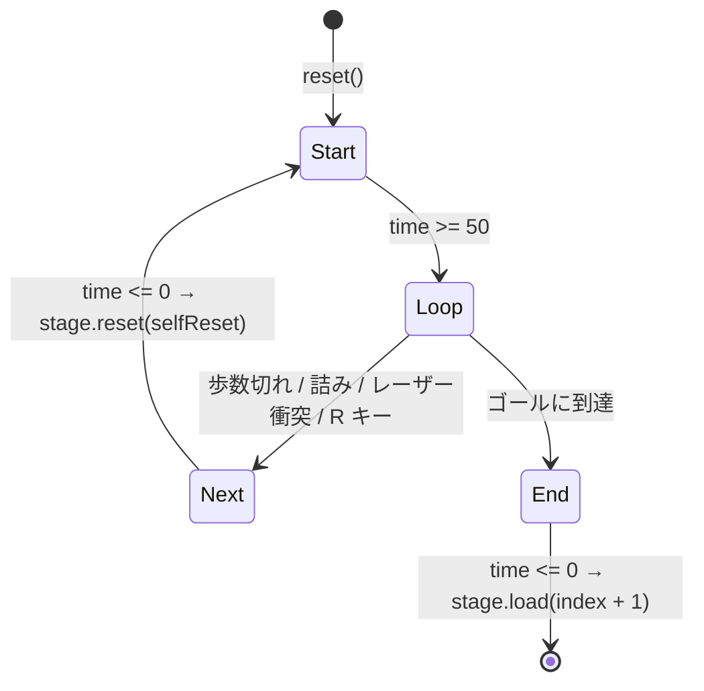

# 01. アーキテクチャ

> 記述時点: `plus` ブランチ フェーズ 1 完了時点。ソース合計 約 1,430 行。

## 1. 全体像

```
index.html
  └ src/main.ts          … PixiJS Application の生成、入力収集、リサイズ、ticker 起動
      └ Game             … シーンの保持と切り替え（title / game / fin）
          ├ Title        … タイトル画面
          ├ Stage        … ゲーム本体（シーン）
          │   ├ Field    … タイルとレーザーの集合（Container）
          │   ├ Player   … 操作キャラ（Entity）
          │   ├ Ghost[]  … 過去のループの分身（Entity）
          │   ├ StageLogic … ルール判定と状態遷移（描画を持たない）
          │   ├ StageView  … 演出（タイルのせり上がり、フェード）
          │   └ UI         … 残歩数ドット、操作説明
          └ Fin          … クリア後の画面
```

`Stage` だけが 4 つの責務（データ読み込み / 構築 / ロジック / ビュー）を抱えており、
現状ここが最も密結合になっている。分離方針は [07-roadmap.md](07-roadmap.md) を参照。

## 2. ファイル一覧と責務

| ファイル | 行数 | 責務 | 備考 |
|---|---:|---|---|
| [src/main.ts](../src/main.ts) | 71 | Pixi 初期化、`app` / `mouse` / `key` / `startTime` のグローバル公開、リサイズ | グローバル可変状態が 4 つある |
| [src/common/observable.ts](../src/common/observable.ts) | 24 | `ObservableValue<T>`。値変更時にリスナを呼ぶ | 変更**前**に通知する点に注意（§5） |
| [src/common/text.ts](../src/common/text.ts) | 21 | 本文テキストの共通スタイル `bodyTextStyle` | フェーズ 1 で追加 |
| [src/game/game.ts](../src/game/game.ts) | 33 | シーンの Map と切り替え | シーンは起動時に全部インスタンス化される |
| [src/game/scene.ts](../src/game/scene.ts) | 8 | `Scene` 抽象クラス（`container` + `update`） | 入退場フックが無い |
| [src/game/title/title.ts](../src/game/title/title.ts) | 63 | タイトル画面、ロゴ SVG 表示、キー入力でステージ 0 へ | 遷移先がハードコード |
| [src/game/fin/fin.ts](../src/game/fin/fin.ts) | 31 | クリア画面、プレイ時間表示 | Text を `update` 内で遅延生成 |
| [src/game/ui/ui.ts](../src/game/ui/ui.ts) | 63 | 残歩数ドット（ParticleContainer）、操作説明 | `Stage` を直接参照 |
| [src/game/stage/stage.ts](../src/game/stage/stage.ts) | 157 | ステージデータのロード、シーン再構築、文字 → タイル変換 | **ここが中心。最も肥大化している** |
| [src/game/stage/stagedata.ts](../src/game/stage/stagedata.ts) | 52 | ステージ JSON の型と定数（`StageData` / `DEFAULT_STEPS` / `PERMANENT_WALL_ID` 等） | フェーズ 1 で追加 |
| [src/game/stage/validate.ts](../src/game/stage/validate.ts) | 119 | ステージデータの検証。`bun run verify` と dev サーバ起動時に走る | フェーズ 1 で追加 |
| [src/game/stage/stages/index.ts](../src/game/stage/stages/index.ts) | 27 | **プレイ順のステージ配列**。ここの並びが順序の正 | フェーズ 1 で追加 |
| [src/game/stage/stagelogic.ts](../src/game/stage/stagelogic.ts) | 150 | 入力処理、移動判定、ループ状態遷移 | ルールの正はここ |
| [src/game/stage/stageview.ts](../src/game/stage/stageview.ts) | 66 | 入退場演出（マンハッタン距離による波） | ロジックの `time` を読むだけ |
| [src/game/stage/field.ts](../src/game/stage/field.ts) | 292 | `Field` / `Tile` / `StartTile` / `EndTile` / `SwitchTile` | タイル定義が全部ここに同居。フェーズ 2 で分割予定 |
| [src/game/stage/entity.ts](../src/game/stage/entity.ts) | 14 | `Entity` 抽象クラス（`grid` / `start`） | `move` が抽象化されていない |
| [src/game/stage/player.ts](../src/game/stage/player.ts) | 50 | プレイヤー。移動履歴 `command` を保持 | `Ghost` とコードがほぼ重複 |
| [src/game/stage/ghost.ts](../src/game/stage/ghost.ts) | 98 | ゴースト。逆再生コマンドと `remainSteps` | `Player` とコードがほぼ重複 |
| [src/game/stage/objects.ts](../src/game/stage/objects.ts) | 59 | `Laser`。フィールド上に置く非タイルオブジェクト | 現状ここに 1 種類だけ |
| [scripts/verify-stages.ts](../scripts/verify-stages.ts) | 36 | `bun run verify` の本体 | フェーズ 1 で追加 |

## 3. 起動から 1 フレームまで



- **入力はポーリング方式。** `keydown`/`keyup` で `key.keys: Set<string>` を更新するだけで、
  実際の判定は `StageLogic.loop()` が毎フレーム Set を走査する（[stagelogic.ts:71-110](../src/game/stage/stagelogic.ts#L71-L110)）。
- リサイズは `app.stage.scale` を一律に変え、レンダラのサイズを追従させる。
  **ゲームコードは常に 1280x720 の座標系で書いてよい。**

## 4. Stage の再構築サイクル

`Stage` は「ループが終わるたびにシーングラフを丸ごと作り直す」設計になっている。



`Stage.reset(init)` がやること（[stage.ts:66-136](../src/game/stage/stage.ts#L66-L136)）:

1. `steps` を JSON から取得（既定 4）
2. `container.destroy()` → `new Container()` で作り直し
3. 背景グラデーションを描画
4. `new Field()` を作り、`tiles` 文字列を 1 文字ずつ `getTile()` でタイル化して登録
5. `objects` 配列を走査してレーザーを登録
6. `init === false` なら、**直前の `player` から `Ghost` を生成**して `ghosts` に追加
   （`maxGhosts` を超えたら古いものを `shift()`）
7. `new Player(start, gap)`
8. `new StageLogic(this)` → `new StageView(this)` → `new UI(this)`

`init` の意味:

| 呼び出し | `init` | 効果 |
|---|---|---|
| `load()` から（新ステージ） | `true` | ゴーストを全消去してやり直し |
| ループ終了（`Next`） | `false` | 直前のプレイヤーをゴースト化して引き継ぐ |
| `R` キーでのリセット | `true` | `selfReset` フラグ経由。ゴーストを消してやり直し |

> `selfReset` は一度 `true` になると戻らない（[stagelogic.ts:104](../src/game/stage/stagelogic.ts#L104)）。
> `StageLogic` はリセットのたびに作り直されるため実害は無いが、意図は分かりにくい。

## 5. `ObservableValue` の注意点

```ts
set value(value: T) {
  this.listeners.forEach(l => l(this._value, value));  // ← 先に通知
  this._value = value;                                  // ← 後で代入
}
```

**リスナが呼ばれた時点では `_value` はまだ古い。** リスナ内で `this.value` を読むと旧値が返る。
そのため `Tile`/`Ghost`/`Laser` のリスナはすべて引数 `(prev, cur)` の `cur` を使っている。
新しくリスナを書く時もこの流儀に従うこと。

また `--g.remainSteps.value` のような複合代入は getter → setter の順で動くため通知は 1 回で正しく動く。

## 6. グローバル状態

| シンボル | 定義 | 用途 |
|---|---|---|
| `app` | [main.ts:4](../src/main.ts#L4) | `Application`。`app.stage` / `app.screen` / `app.renderer` を各所が直接触る |
| `key` | [main.ts:10](../src/main.ts#L10) | 押下中のキー集合。`pressed` は「何か押されている」 |
| `mouse` | [main.ts:5](../src/main.ts#L5) | 現状**未使用**（将来のマウス操作用） |
| `startTime` | [main.ts:15](../src/main.ts#L15) | `Fin` のプレイ時間計算にのみ使用 |

`app` は `main.ts` の即時関数内で代入されるため、**モジュールのトップレベルで `app` を参照してはいけない**
（`undefined` になる）。必ずコンストラクタ以降で触る。

## 7. ビルドと配信

- ステージデータは [stages/index.ts](../src/game/stage/stages/index.ts) の明示 import。
  開発ビルド（`import.meta.env.DEV`）では [stage.ts](../src/game/stage/stage.ts) の
  モジュール読み込み時に `validateAllStages()` が走る。
- `vite.config.ts` の `build.outDir` が `docs`、`base` が `./`。
  → `bun run build` すると `docs/` が GitHub Pages 用の成果物として更新される。
- `src-tauri/tauri.conf.json` の `frontendDist` も `../docs` を指しており、Web とデスクトップで同じ出力を共有する。
- Tauri 側の Rust コード（`greet` コマンド）は**テンプレートのまま未使用**。

## 8. 依存

| パッケージ | バージョン | 用途 |
|---|---|---|
| `pixi.js` | ^8.18.1 | 描画のすべて |
| `@tauri-apps/api` / `plugin-opener` | ^2 | デスクトップ殻（現状フロントからは未呼び出し） |
| `vite` / `typescript` | ^6.4 / ~5.6 | ビルド |

外部のゲームエンジン・状態管理・テストフレームワークは入っていない。
