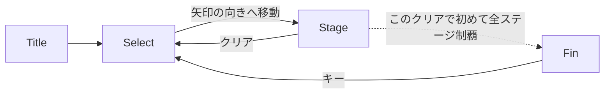
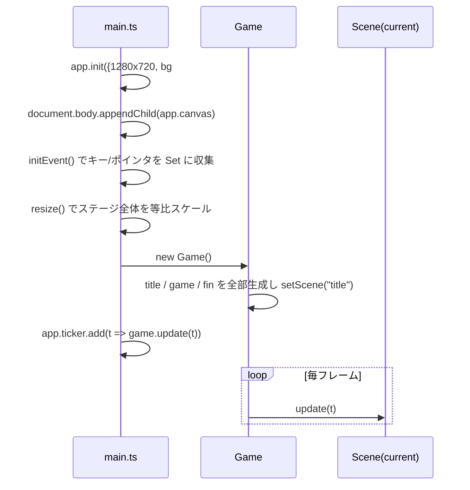
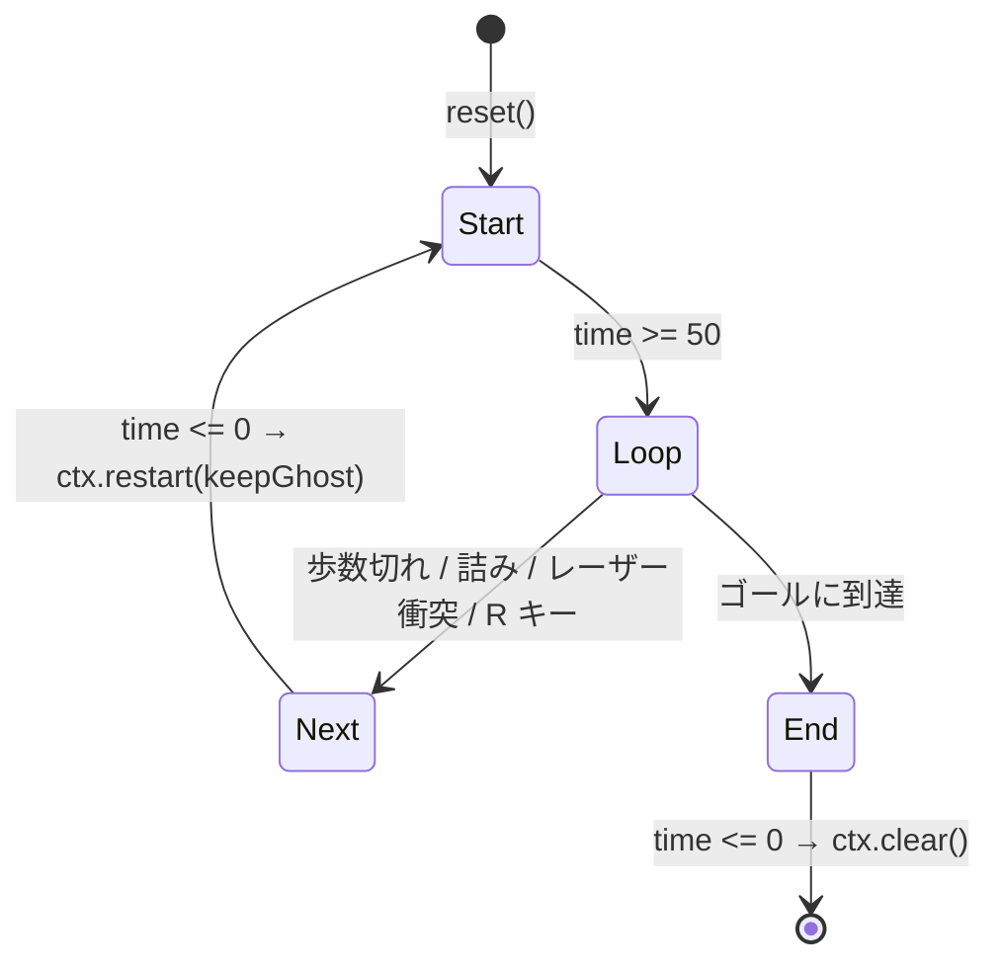

# 01. アーキテクチャ

> 記述時点: `plus` ブランチ フェーズ 4（選択画面）実装時点。ソース合計 約 2,900 行。

## 1. 全体像

```
index.html
  └ src/main.ts          … PixiJS Application の生成、入力収集、リサイズ、ticker 起動
      └ Game             … シーンの保持・切り替え・遷移の仲介（title / select / game / fin）
          ├ Title        … タイトル画面
          ├ Select       … ステージ選択画面（歩き回るワールドマップ）
          │   ├ Field    … ステージと同じ Field。タイルは消費されない
          │   ├ Player   … ステージと同じ自機
          │   └ SelectView … カメラ、ステージ番号ラベル、矢印
          ├ Stage        … ゲーム本体（シーン）。StageContext を実装する
          │   ├ Field    … タイルとレーザーの集合（Container）
          │   ├ Player   … 操作キャラ（Entity）
          │   ├ Ghost[]  … 過去のループの分身（Entity）
          │   ├ StageLogic   … ルール。描画にも入力にも依存しない
          │   ├ KeyboardInput … キー入力 → StageLogic の操作
          │   ├ StageView    … 演出（タイルのせり上がり、フェード）
          │   └ UI           … 残歩数ドット、操作説明
          └ Fin          … クリア後の画面

scripts/verify.ts （bun run verify）
  ├ Sim                  … StageContext を実装したヘッドレス版
  │   └ StageLogic       … ↑ とまったく同じインスタンス
  └ analyzeSelectMap     … 選択マップが地形ロックで詰まないかを検査
```

### シーン遷移



遷移は `Game.openSelect()` / `Game.playStage()` / `Game.returnToSelect()` / `Game.leaveFin()` が仲介する。
クリアの記録（`markCleared`）も `Game.returnToSelect()` が付ける。
「このクリアで全ステージが揃ったか」を判定するのに、記録前の状態が要るため。
**シーン同士は互いを import しない**（`Stage` と `Select` の循環参照を避けるため）。
`Scene` には `enter()` / `exit()` があり、再入場する画面の初期化はコンストラクタではなくそこに書く。

### ルールと描画の分離

フェーズ 2 で **`StageLogic` から PixiJS と入力への依存を切った。**

- `StageLogic` が知っているのは [`StageContext`](../src/game/stage/stagelogic.ts) だけ
  （`field` / `player` / `ghosts` / `steps` と、`restart()` / `clear()` の 2 つのコールバック）。
- 入力は [`KeyboardInput`](../src/game/stage/stageinput.ts) が `tryMove()` / `requestReset()` を
  呼ぶ形で外から与える。
- おかげで [`solver.ts`](../src/game/stage/solver.ts) の `Sim` が `StageContext` を実装するだけで、
  **ルールを一切再実装せずに**ステージが解けるかを検証できる。

> PixiJS v8 の `Container` / `Graphics` は描画コンテキストが無くても構築できるので、
> `Field` / `Tile` / `Player` / `Ghost` はヘッドレス（bun）でもそのまま動く。
> **ルールに関わるコードで `app`（レンダラ）を参照しないこと。** 参照した瞬間にソルバが動かなくなる。

## 2. ファイル一覧と責務

| ファイル | 行数 | 責務 | 備考 |
|---|---:|---|---|
| [src/main.ts](../src/main.ts) | 70 | Pixi 初期化、`app` / `mouse` / `key` / `startTime` のグローバル公開、リサイズ | グローバル可変状態が 4 つある |
| [src/common/observable.ts](../src/common/observable.ts) | 24 | `ObservableValue<T>`。値変更時にリスナを呼ぶ | 変更**前**に通知する点に注意（§5） |
| [src/common/text.ts](../src/common/text.ts) | 21 | 本文テキストの共通スタイル `bodyTextStyle` | |
| [src/common/interpolate.ts](../src/common/interpolate.ts) | 14 | `damp()`。フレームレート非依存の一次遅れ補間 | 補間は必ずこれを通す |
| [src/common/progress.ts](../src/common/progress.ts) | 87 | クリア記録とイベント再生記録の localStorage 保存 | 壊れた値でも落ちない |
| [src/common/screen.ts](../src/common/screen.ts) | 10 | 論理解像度 `SCREEN_WIDTH` / `SCREEN_HEIGHT` | `app.screen.*` を位置計算に使わない |
| [src/common/background.ts](../src/common/background.ts) | 20 | 共通の背景グラデーション | ステージと選択画面で共有 |
| [src/game/game.ts](../src/game/game.ts) | 73 | シーンの保持・切り替え・**遷移の仲介** | シーンは起動時に全部インスタンス化される |
| [src/game/scene.ts](../src/game/scene.ts) | 19 | `Scene` 抽象クラス（`container` / `update` / `enter` / `exit`） | 再入場時の初期化は `enter()` に書く |
| [src/game/title/title.ts](../src/game/title/title.ts) | 63 | タイトル画面、ロゴ SVG 表示、キー入力でステージ 0 へ | 遷移先がハードコード |
| [src/game/fin/fin.ts](../src/game/fin/fin.ts) | 38 | クリア画面、プレイ時間表示 | Text は `enter()` で作る |
| [src/game/ui/ui.ts](../src/game/ui/ui.ts) | 63 | 残歩数ドット（ParticleContainer）、操作説明 | `Stage` を直接参照 |
| **ルール（描画・入力に依存しない）** | | | |
| [src/game/stage/direction.ts](../src/game/stage/direction.ts) | 43 | `Direction` と `offsetOf` / `opposite` / `directionFromKey` | 方向の計算はすべてここ経由 |
| [src/game/stage/tiles.ts](../src/game/stage/tiles.ts) | 306 | `TileState` / `Tile` / `StartTile` / `EndTile` / `SwitchTile` / `DoubleTile` / **`tileRegistry`** | **新しいタイルはここに 1 行** |
| [src/game/stage/objects.ts](../src/game/stage/objects.ts) | 99 | `Laser` と **`objectRegistry`** | **新しいギミックはここに 1 行** |
| [src/game/stage/field.ts](../src/game/stage/field.ts) | 139 | `Field`。タイル/レーザーの集合、座標変換、詰み判定、ターン通知 | スイッチ→レーザーの結線もここ |
| [src/game/stage/entity.ts](../src/game/stage/entity.ts) | 55 | `Entity`。グリッド移動・補間・レーザーへの突っ込み演出 | `Player`/`Ghost` の共通部 |
| [src/game/stage/player.ts](../src/game/stage/player.ts) | 38 | プレイヤー。移動履歴 `command` を保持 | 常に `solid` |
| [src/game/stage/ghost.ts](../src/game/stage/ghost.ts) | 105 | ゴースト。逆再生コマンドと `remainSteps`、`rewind()` | `remainSteps > 0` の間だけ `solid` |
| [src/game/stage/stagelogic.ts](../src/game/stage/stagelogic.ts) | 189 | **ルールの正**。`StageContext` / `LogicState` / `tryMove` / `requestReset` | PixiJS の `Ticker` 型以外に描画依存なし |
| **データ** | | | |
| [src/game/stage/stagedata.ts](../src/game/stage/stagedata.ts) | 63 | ステージ JSON の型と定数 | `StageData` / `DEFAULT_STEPS` / `MAX_GHOSTS` ほか |
| [src/game/stage/stages/index.ts](../src/game/stage/stages/index.ts) | 27 | **プレイ順のステージ配列**。ここの並びが順序の正 | |
| [src/game/stage/validate.ts](../src/game/stage/validate.ts) | 125 | ステージデータの検証 | dev サーバ起動時と `bun run verify` |
| **選択画面** | | | |
| [src/game/select/select.ts](../src/game/select/select.ts) | 368 | 選択画面シーン。組み立て・移動・イベント演出・スイッチ | 書式は [08](08-select-format.md) |
| [src/game/select/selectdata.ts](../src/game/select/selectdata.ts) | 101 | 選択マップの型と `exitLabel()` | |
| [src/game/select/selectmap.ts](../src/game/select/selectmap.ts) | 108 | **マップの読み方（純粋関数）**。入口・開始位置・条件判定 | シーンと検証が共有する |
| [src/game/select/selecttiles.ts](../src/game/select/selecttiles.ts) | 245 | `FreeTile` / `BlockedTile` / `StageTile` / `SelectSwitchTile` / `HiddenTile` / `ExitArrow` + `createSelectTile()` | 踏んでも `Used` にならない |
| [src/game/select/selectview.ts](../src/game/select/selectview.ts) | 140 | カメラ、ステージ番号ラベル、入退場アニメ | |
| [src/game/select/validate.ts](../src/game/select/validate.ts) | 194 | 選択マップの検証 | |
| [src/game/select/reachability.ts](../src/game/select/reachability.ts) | 108 | **地形ロックで詰まないかの解析** | ゲーム本体と同じ Field を使う |
| [src/game/select/maps/index.ts](../src/game/select/maps/index.ts) | 12 | ワールドの並び順 | |
| **描画・入力・検証** | | | |
| [src/game/stage/stage.ts](../src/game/stage/stage.ts) | 156 | シーン。`StageContext` を実装し、データからシーングラフを組み立てる | |
| [src/game/stage/stageinput.ts](../src/game/stage/stageinput.ts) | 43 | キー入力 → `StageLogic` の操作 | ここだけが `key` を読む |
| [src/game/stage/stageview.ts](../src/game/stage/stageview.ts) | 51 | ステージの入退場演出 | `logic.time` を読むだけ |
| [src/game/stage/fieldanim.ts](../src/game/stage/fieldanim.ts) | 50 | `applyWave()` / `entityAlpha()`。入退場演出の実体 | ステージと選択画面で共有 |
| [src/game/stage/solver.ts](../src/game/stage/solver.ts) | 255 | ヘッドレスな `StageContext` 実装、ソルバ、`playRoute()` | **ゲーム本体からは import されない** |
| [scripts/verify.ts](../scripts/verify.ts) | 146 | `bun run verify` の本体 | ステージ + 選択マップ |

## 3. 起動から 1 フレームまで



- **入力はポーリング方式。** `keydown`/`keyup` で `key.keys: Set<string>` を更新するだけで、
  実際の判定は [`KeyboardInput.update()`](../src/game/stage/stageinput.ts) が毎フレーム Set を走査し、
  `StageLogic.tryMove()` / `requestReset()` を呼ぶ。**`key` を読むのはこのファイルだけ。**
- リサイズは `app.stage.scale` を一律に変え、レンダラのサイズを追従させる。
  **ゲームコードは常に 1280x720 の座標系で書いてよい。**

## 4. Stage の再構築サイクル

`Stage` は「ループが終わるたびにシーングラフを丸ごと作り直す」設計になっている。



`StageLogic` は自分では何も作り直さない。時間切れになったら `StageContext` の
`restart()` / `clear()` を呼ぶだけで、実際の作り直しは `Stage` が行う。

`Stage.reset(init)` がやること（[stage.ts の reset()](../src/game/stage/stage.ts)）:

1. `steps` をステージデータから取得（既定 `DEFAULT_STEPS`）
2. `container.destroy()` → `new Container()` で作り直し
3. 背景グラデーションを描画
4. `new Field()` を作り、`tiles` 文字列を 1 文字ずつ `createTile()` でタイル化して登録
5. `objects` 配列を `createObject()` でインスタンス化して登録
6. `init === false` なら、**直前の `player` から `Ghost` を生成**して `ghosts` に追加
   （`MAX_GHOSTS` を超えたら古いものを `shift()`）
7. `new Player(start, gap)`
8. `new StageLogic(this)` → `new KeyboardInput()` → `new StageView(this)` → `new UI(this)`

`init` の意味:

| 呼び出し | `init` | 効果 |
|---|---|---|
| `load()` から（新ステージ） | `true` | ゴーストを全消去してやり直し |
| ループ終了（`restart(true)`） | `false` | 直前のプレイヤーをゴースト化して引き継ぐ |
| `R` キーでのリセット（`restart(false)`） | `true` | ゴーストを消してやり直し |

**ソルバ（[solver.ts](../src/game/stage/solver.ts) の `Sim`）もこの 1〜8 と同じ手順を踏む。**
ここの順序を変えたら `Sim.build()` も合わせること。

## 5. `ObservableValue` の注意点

```ts
set value(value: T) {
  this.listeners.forEach(l => l(this._value, value));  // ← 先に通知
  this._value = value;                                  // ← 後で代入
}
```

**リスナが呼ばれた時点では `_value` はまだ古い。** リスナ内で `this.value` を読むと旧値が返る。
そのため `Tile`/`Ghost`/`Laser` のリスナはすべて引数 `(prev, cur)` の `cur` を使っている。
新しくリスナを書く時もこの流儀に従うこと。

また `--g.remainSteps.value` のような複合代入は getter → setter の順で動くため通知は 1 回で正しく動く。

## 6. グローバル状態

| シンボル | 定義 | 用途 |
|---|---|---|
| `app` | [main.ts:4](../src/main.ts#L4) | `Application`。`app.stage` / `app.screen` / `app.renderer` を各所が直接触る |
| `key` | [main.ts:10](../src/main.ts#L10) | 押下中のキー集合。`pressed` は「何か押されている」 |
| `mouse` | [main.ts:5](../src/main.ts#L5) | 現状**未使用**（将来のマウス操作用） |
| `startTime` | [main.ts:15](../src/main.ts#L15) | `Fin` のプレイ時間計算にのみ使用 |

`app` は `main.ts` の即時関数内で代入されるため、**モジュールのトップレベルで `app` を参照してはいけない**
（`undefined` になる）。必ずコンストラクタ以降で触る。

また **`app.screen.width` / `app.screen.height` はウィンドウ依存の実ピクセル値**であり、
ゲーム内の位置やアニメーションの距離に使ってはいけない。
論理解像度は [`SCREEN_WIDTH` / `SCREEN_HEIGHT`](../src/common/screen.ts) を使う。

## 7. ビルドと配信

- ステージデータは [stages/index.ts](../src/game/stage/stages/index.ts) の明示 import。
  開発ビルド（`import.meta.env.DEV`）では [stage.ts](../src/game/stage/stage.ts) の
  モジュール読み込み時に `validateAllStages()` が走る。
- `vite.config.ts` の `build.outDir` が `docs`、`base` が `./`。
  → `bun run build` すると `docs/` が GitHub Pages 用の成果物として更新される。
- `src-tauri/tauri.conf.json` の `frontendDist` も `../docs` を指しており、Web とデスクトップで同じ出力を共有する。
- Tauri 側の Rust コード（`greet` コマンド）は**テンプレートのまま未使用**。

## 8. 依存

| パッケージ | バージョン | 用途 |
|---|---|---|
| `pixi.js` | ^8.18.1 | 描画のすべて |
| `@tauri-apps/api` / `plugin-opener` | ^2 | デスクトップ殻（現状フロントからは未呼び出し） |
| `vite` / `typescript` | ^6.4 / ~5.6 | ビルド |

外部のゲームエンジン・状態管理・テストフレームワークは入っていない。
