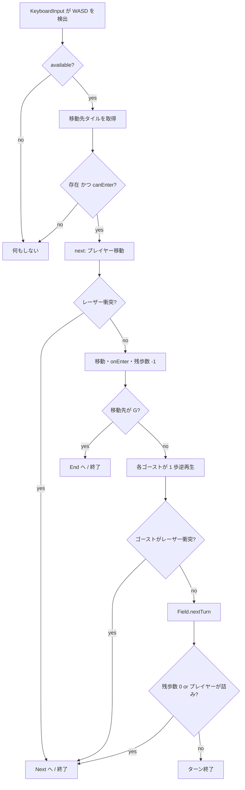

# 02. ゲームルール仕様

> **この章は現行実装の厳密な記述である。** 直感的な説明ではなく、コードがそう動くという事実を書いている。
> ルールを変更したらこの章も必ず更新し、**`bun run verify` を通すこと**（既存ステージが解けるか自動検証される）。
> 正の実装は [stagelogic.ts](../src/game/stage/stagelogic.ts) / [field.ts](../src/game/stage/field.ts) / [tiles.ts](../src/game/stage/tiles.ts)。

## 1. 基本ルール

- フィールドは 2 次元グリッド。タイルのある座標だけが足場。
- プレイヤーは `W/A/S/D` で上下左右に 1 マスずつ移動する。
- **進入したタイルは `Used` になり、二度と進入できない。** これが一筆書きの制約。
- プレイヤーは 1 ループにつき `steps` 回だけ動ける（画面上部のドット列が残数）。
- `G`（ゴールタイル）に進入するとステージクリア。

### 入力の性質

入力の解釈は [`KeyboardInput`](../src/game/stage/stageinput.ts) が担当し、
ルール側（`StageLogic`）は `tryMove(dir)` / `requestReset()` を受けるだけ。

- **1 回の押下につき 1 マス。** 押しっぱなしでは進まない。
  内部フラグ `available` は「キーが 1 つも押されていないフレーム」でのみ `true` に戻る。
- 複数キー同時押しの場合、`Set` の挿入順で最初に見つかった `WASD` が採用される。
- `R` はリセット。**移動キーより先に独立して判定される**ので、移動キーを押しながらでも効く。

## 2. ループ

「ループ」は、プレイヤーが動ける 1 区切り。終了するとフィールドが JSON から作り直され、
プレイヤーは `S` に戻り、歩数も全回復する。**ただしゴーストが 1 体残る。**

### ループの終了条件

| 条件 | 判定箇所 | 遷移先 |
|---|---|---|
| 残歩数が 0 になった | `StageLogic.tryMove()`（ゴーストの移動後） | `Next`（ゴースト継承あり） |
| 詰み（進める方向が 1 つも無い） | `StageLogic.tryMove()`（ゴーストの移動後） | `Next` |
| 進行方向にアクティブなレーザーがある | `StageLogic.next()` | `Next` |
| `R` キー | `StageLogic.requestReset()` | `Next`（`keepGhost = false` → ゴースト**破棄**） |
| `G` に進入 | `StageLogic.next()` | `End` → 次ステージ |

> ゴール判定は残歩数チェックより**先**に行われるため、最後の 1 歩でゴールしてもクリアになる。
> レーザー判定はゴール判定より**先**なので、ゴール直前のレーザーはちゃんと塞ぐ。

## 3. ゴースト — このゲームの核

ループが終わると（`R` リセットを除く）、そのループでのプレイヤーが `Ghost` になる。

### 3.1 経路

- ゴーストは**プレイヤーが最後にいた位置**から出発する（`Stage.reset()` の `new Ghost(...)`）。
- ゴーストのコマンド列は、プレイヤーの移動履歴 `command` の各方向を**反転**したもの
  （[ghost.ts](../src/game/stage/ghost.ts) のコンストラクタ）。
- 実行時は `command.pop()` で**末尾から**取り出す（`StageLogic.tryMove()`）。
  → 結果として、**プレイヤーの軌跡を終点から始点へ逆再生する。**
- ゴーストが動くのは、**プレイヤーが移動に成功したフレームだけ**。
  プレイヤーとゴーストは常に同時に 1 歩進む。

### 3.2 実体（solid）と非実体

ゴーストは `remainSteps` を持ち、この値が `> 0` の間だけ**実体を持つ**。

| | 実体あり (`remainSteps > 0`) | 実体なし (`remainSteps === 0`) |
|---|---|---|
| タイルを `Used` にする | する（＝プレイヤーの邪魔をする） | しない |
| レーザーに阻まれる | 阻まれる（ループ終了） | 素通りする |
| スイッチを押す | 押す | **押す**（`SwitchTile.onEnter()` が `solid` を見ない） |
| 見た目 | 濃い二重枠（alpha 0.9） | 薄い枠（alpha 0.5）[ghost.ts](../src/game/stage/ghost.ts) |

> **スイッチだけは実体の有無に関係なく押せる。** これは仕様であり、ステージ 2 の解法の核心（§6）。

### 3.3 `remainSteps` の初期値 — 「歩数の保存則」

ゴーストの `remainSteps` の初期値は、**そのループでプレイヤーが余らせた歩数**
（`Stage.reset()` が `new Ghost(this.player, this.logic.remainSteps)` で渡す）。

- ループ開始時、ゴーストは出発タイルを占有して `remainSteps` を 1 消費する
  （`StageLogic` のコンストラクタ）。
- 以降 1 歩ごとに 1 消費する（`StageLogic.next()`）。

つまり:

```
プレイヤーが使った歩数 + ゴーストが実体でいる歩数 = steps
```

**急いでゴールを目指すほど、次のループのゴーストは薄く（邪魔にならなく）なる。**
逆に、途中で詰まって歩数を余らせるほど、次ループのゴーストは長く実体を保つ。
ステージ設計はこの綱引きの上に成り立っている。

### 3.4 ゴーストの数

**ステージごとに設定できる。** `stages/*.json` の `ghosts`（省略時は 1）。

- ループが終わるたびに新しいゴーストが 1 体増える。
- 上限に達していると、**いちばん古いゴーストを捨てる**（直近 N ループぶんが残る）。
- 生き残ったゴーストは、ループが始まるたびに `Ghost.rewind()` で
  **生成されたときの状態（開始位置・コマンド列・実体歩数）へ巻き戻される。**
  これを忘れると 2 体目以降がまったく動かない。

複数体にすると「2 つのスイッチを同時に押さえ続ける」といった手が成立する
（ステージ 8 がその例）。

> 上限は `MAX_GHOSTS_LIMIT`（4）。増やしすぎると盤面が読めなくなる。

## 4. タイル

| 文字 | クラス | 説明 |
|---|---|---|
| `S` | `StartTile` | プレイヤーの初期位置。赤い三角。ロジック開始時に `Used` になる |
| `G` | `EndTile` | ゴール。赤い四角 |
| `#` | `Tile` | 通常タイル（`Unused`） |
| `@` | `Tile` | 通常タイルだが**最初から `Used`**（進入不可の障害物） |
| `=` | `DoubleTile` | 2 回まで通れる。実体を持つものが通るたびに残り回数が減る |
| `a`〜`z` | `SwitchTile` | スイッチ。文字がそのまま ID になる |
| 空白・その他 | — | タイル無し |

変換は [tiles.ts](../src/game/stage/tiles.ts) の `tileRegistry` と `createTile()`。

### タイル状態

`TileState.Used` / `TileState.Unused` の 2 値（[tiles.ts](../src/game/stage/tiles.ts)）。
`Used` になると描画 alpha が 0.2 に向かって補間される。

進入の可否と進入時の処理は `Tile` の 3 つのメンバに集約されている。

| メンバ | 意味 |
|---|---|
| `canEnter(): boolean` | 進入できるか。既定は `state === Unused` |
| `onEnter(solid: boolean): void` | 進入されたときの処理。既定は `solid` なら `Used` にする |
| `get isGoal(): boolean` | 進入したらクリアか。`EndTile` だけ `true` |
| `fingerprint(): string` | ソルバが「同じ状態か」を判定するための指紋 |

> **状態を持つタイルを足したら `fingerprint()` を必ず override すること。**
> 混ぜ忘れると、ソルバが異なる状態を同一とみなして解を取りこぼす。

**状態は `Used → Unused` に戻らない**（コード上は対応しているが、そうする経路が無い）。

### スイッチタイル

- 進入するか、ループ開始時にそのタイル上にいると `pushed = true` になる。
- `pushed` になると、**同じ ID を持つすべてのレーザーが非アクティブになる**
  結線は `Field.addTile()` が行う（タイルは `Field` を参照しない）。
- **一度押すとそのループ中は戻らない。** 色が水色 `#5fc3c9` → 灰色 `#a4b1b2` に変わる。
- ループが終わるとフィールドごと作り直されるので、押下状態もリセットされる。

## 5. レーザー

- タイルとタイルの**辺**に置く障害物（[objects.ts](../src/game/stage/objects.ts)）。
- 座標は**片方が `.5` の半整数**。例: `{x: 7.5, y: 0}` はタイル `(7,0)` と `(8,0)` の間。
- `vertical = Math.round(y) === y`、つまり **`y` が整数なら縦向きのビーム**（横方向の通行を塞ぐ）。
- `id` が `SwitchTile` の文字と一致すると、そのスイッチで無効化される。
- 実体のあるエンティティが横切ろうとすると、半歩だけ突っ込んで止まりループ終了
  （`StageLogic.next()` の先頭）。

判定は [field.ts](../src/game/stage/field.ts) の `existsLaser()`:

```ts
// (x,y) から dir 方向へ動くとき、その中間座標にアクティブなレーザーがあるか
Up:    y -= 0.5    Down:  y += 0.5
Right: x += 0.5    Left:  x -= 0.5
```

## 6. 詰み判定 (`isJammed`)

[field.ts](../src/game/stage/field.ts) の `isJammed()`。

```
どの方向にも「進入できるタイルがあり、かつその辺にアクティブなレーザーが無い」が
成り立たなければ詰み
```

つまり詰みは次の 3 つで決まる。

- 隣にタイルが無い
- 隣のタイルが `canEnter()` でない（`Used` など）
- 隣へ行く辺がアクティブなレーザーで塞がれている

> フェーズ 3 より前は 3 つ目が効いておらず、レーザーに完全包囲されても詰み判定が出なかった
> （[06-known-issues.md の L-1](06-known-issues.md)、修正済み）。

## 7. 1 ターンの処理順序

`StageLogic.tryMove(dir)` が行うこと:



### ⚠️ 判定順の決まり（変えてはいけない）

**歩数切れと詰みの判定は、ゴーストが動いたあとに行う。**

ゴーストはスイッチを踏んでレーザーを開けることがある。
プレイヤーの移動直後に判定してしまうと、

```
自機が行き止まりへ移動 → まだレーザーが閉じている → 詰み判定でループ終了
```

となり、**「ゴーストが道を開けてくれるのを同じターンで待つ」手が成立しなくなる。**
正しくは:

```
自機が行き止まりへ移動 → ゴーストが移動してスイッチを踏む → レーザー解除 → 詰みではない
```

これはステージ 4 の本来の解法（`SDWDSAA`）そのもので、
[scripts/verify.ts](../scripts/verify.ts) の `KNOWN_ROUTES` に固定してある。
判定順を戻すと `bun run verify` が落ちる。

**プレイヤーとゴーストは必ず同時に 1 歩進む。** 例外は無い
（最後の 1 歩でも、レーザーに阻まれて動けなかったとき以外はゴーストも動く）。

## 8. 演出タイミング

`StageLogic.time` が全演出の時間軸（単位は `Ticker.deltaTime`、60fps で 1 フレーム ≒ 1）。

| 状態 | `time` の動き | 意味 |
|---|---|---|
| `Start` | `-20` → `50` | タイルがせり上がって出現（約 70 フレーム ≒ 1.2 秒） |
| `Loop` | `50` 固定 | 操作可能 |
| `Next` | `70` → `0` | タイルが沈んで消える → `stage.reset()` |
| `End` | `70` → `0` | 同上 → `stage.load(index + 1)` |

`StageView` はこの `time` を 0〜50 にクランプして、タイルごとの
**マンハッタン距離 `x + y`** に応じた遅延で波状に animation させる
（[stageview.ts](../src/game/stage/stageview.ts)）。
プレイヤーとゴーストと UI は `time` が 45 を超えてから点滅しながらフェードインする。

## 9. ステージ 2 の解法（ルールの理解確認用）

```
tiles: "a###S###G"   steps: 4
laser a: x=7.5, y=0  … タイル(7,0) と (8,0) の間 ＝ ゴールの直前
```

- ゴールはちょうど 4 歩右だが、直前がレーザーで塞がれている。
- スイッチ `a` はちょうど 4 歩左。

**ループ 1**: 左に 4 歩進んでスイッチ `a` に乗る。歩数を使い切ったのでループ終了。
余り歩数 0 → **実体を持たないゴースト**が生成される。

**ループ 2**: ゴーストはスイッチ `a` の上から始まる。
実体は無いがスイッチは押せるので、**レーザー `a` が無効化される**。
プレイヤーは右に 4 歩進んでゴール。

この「実体が無くてもスイッチは押せる」「ゴーストは自分の軌跡を逆再生する」の
2 点が理解できていれば、ステージ設計は書ける。

## 10. ルールの自動検証

`bun run verify` は [solver.ts](../src/game/stage/solver.ts) の `Sim` を使って
**この章に書いたルールをそのまま**（＝ゲーム本体と同じ `StageLogic` を）動かし、
全ステージが解けることを確認する。

現在の最小ループ数と、ソルバが見つけた手順:

| # | 最小ループ数 | 手順（W/A/S/D） |
|---|---:|---|
| 1 | 1 | `DDDD` |
| 2 | 2 | `AAAADDDD` |
| 3 | 2 | `DDDWADS` |
| 4 | 2 | `SDWDSAA` |
| 5 | 2 | `DSSDWDSDDDDDDDDDD` |
| 6 | 2 | `DSSDDWWADSSDSS` |
| 7 | 4 | `DWWDDDDSSADSSSDDWDWWDDDDSSADDD` |
| 8 | 3 | `DDAASS`（ゴースト 2 体） |
| 9 | 2 | `SDAASS`（`=` を 1 ループで 2 回通る） |

**回帰検出の対象は「最小ループ数」**と、`KNOWN_ROUTES` に固定した既知の手順。
上の表のうち固定してあるのはステージ 4 の 2 つだけで、
他の手順の文字列は探索順に依存するので契約ではない。

> ソルバは「解が存在するか」しか見ない。**別解があると、意図した手順が壊れても気づけない。**
> ルールの意図を守りたい手順は `KNOWN_ROUTES` に足すこと。
期待値は [scripts/verify.ts](../scripts/verify.ts) の `EXPECTED_LOOPS` に固定してあり、
ずれると `bun run verify` が落ちる。意図した変更なら期待値とこの表を更新すること。

> ステージ 2 の `AAAADDDD` は §9 で手で導いた解法とまったく同じ。
> 「実体を持たないゴーストでもスイッチは押せる」が効いている証拠になっている。
