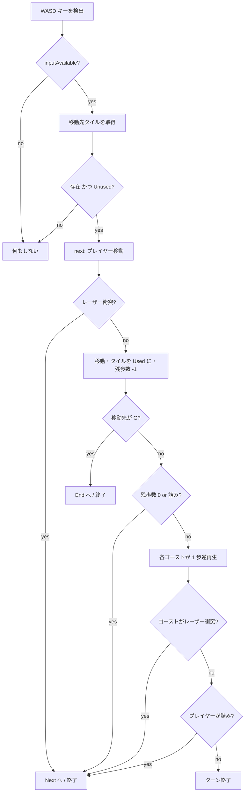

# 02. ゲームルール仕様

> **この章は現行実装の厳密な記述である。** 直感的な説明ではなく、コードがそう動くという事実を書いている。
> ルールを変更したらこの章も必ず更新すること。正の実装は [stagelogic.ts](../src/game/stage/stagelogic.ts) と [field.ts](../src/game/stage/field.ts)。

## 1. 基本ルール

- フィールドは 2 次元グリッド。タイルのある座標だけが足場。
- プレイヤーは `W/A/S/D` で上下左右に 1 マスずつ移動する。
- **進入したタイルは `Used` になり、二度と進入できない。** これが一筆書きの制約。
- プレイヤーは 1 ループにつき `steps` 回だけ動ける（画面上部のドット列が残数）。
- `G`（ゴールタイル）に進入するとステージクリア。

### 入力の性質

- **1 回の押下につき 1 マス。** 押しっぱなしでは進まない。
  `inputAvailable` は「キーが 1 つも押されていないフレーム」でのみ `true` に戻る
  （[stagelogic.ts:107-109](../src/game/stage/stagelogic.ts#L107-L109)）。
- 複数キー同時押しの場合、`Set` の挿入順で最初に見つかった `WASD` が採用される。
- `R` はリセット。ただし `WASD` のいずれかが先に見つかると同フレームでは評価されない
  （[stagelogic.ts:73-106](../src/game/stage/stagelogic.ts#L73-L106)）。

## 2. ループ

「ループ」は、プレイヤーが動ける 1 区切り。終了するとフィールドが JSON から作り直され、
プレイヤーは `S` に戻り、歩数も全回復する。**ただしゴーストが 1 体残る。**

### ループの終了条件

| 条件 | 判定箇所 | 遷移先 |
|---|---|---|
| 残歩数が 0 になった | [stagelogic.ts:142](../src/game/stage/stagelogic.ts#L142) | `Next`（ゴースト継承あり） |
| 詰み（隣接する `Unused` タイルが無い） | [stagelogic.ts:142](../src/game/stage/stagelogic.ts#L142), [:95](../src/game/stage/stagelogic.ts#L95) | `Next` |
| 進行方向にアクティブなレーザーがある | [stagelogic.ts:114-125](../src/game/stage/stagelogic.ts#L114-L125) | `Next` |
| `R` キー | [stagelogic.ts:102-105](../src/game/stage/stagelogic.ts#L102-L105) | `Next`（`selfReset = true` → ゴースト**破棄**） |
| `G` に進入 | [stagelogic.ts:135-138](../src/game/stage/stagelogic.ts#L135-L138) | `End` → 次ステージ |

> ゴール判定は残歩数チェックより**先**に行われるため、最後の 1 歩でゴールしてもクリアになる。
> レーザー判定はゴール判定より**先**なので、ゴール直前のレーザーはちゃんと塞ぐ。

## 3. ゴースト — このゲームの核

ループが終わると（`R` リセットを除く）、そのループでのプレイヤーが `Ghost` になる。

### 3.1 経路

- ゴーストは**プレイヤーが最後にいた位置**から出発する（[stage.ts:125](../src/game/stage/stage.ts#L125)）。
- ゴーストのコマンド列は、プレイヤーの移動履歴 `command` の各方向を**反転**したもの
  （[ghost.ts:27-34](../src/game/stage/ghost.ts#L27-L34)）。
- 実行時は `command.pop()` で**末尾から**取り出す（[stagelogic.ts:89](../src/game/stage/stagelogic.ts#L89)）。
  → 結果として、**プレイヤーの軌跡を終点から始点へ逆再生する。**
- ゴーストが動くのは、**プレイヤーが移動に成功したフレームだけ**（[stagelogic.ts:88-93](../src/game/stage/stagelogic.ts#L88-L93)）。
  プレイヤーとゴーストは常に同時に 1 歩進む。

### 3.2 実体（solid）と非実体

ゴーストは `remainSteps` を持ち、この値が `> 0` の間だけ**実体を持つ**。

| | 実体あり (`remainSteps > 0`) | 実体なし (`remainSteps === 0`) |
|---|---|---|
| タイルを `Used` にする | する（＝プレイヤーの邪魔をする） | しない |
| レーザーに阻まれる | 阻まれる（ループ終了） | 素通りする |
| スイッチを押す | 押す | **押す**（[stagelogic.ts:139-141](../src/game/stage/stagelogic.ts#L139-L141)） |
| 見た目 | 濃い二重枠（alpha 0.9） | 薄い枠（alpha 0.5）[ghost.ts:71-83](../src/game/stage/ghost.ts#L71-L83) |

> **スイッチだけは実体の有無に関係なく押せる。** これは仕様であり、ステージ 2 の解法の核心（§6）。

### 3.3 `remainSteps` の初期値 — 「歩数の保存則」

ゴーストの `remainSteps` の初期値は、**そのループでプレイヤーが余らせた歩数**
（`stage.logic.remainSteps`, [stage.ts:125](../src/game/stage/stage.ts#L125)）。

- ループ開始時、ゴーストは出発タイルを占有して `remainSteps` を 1 消費する
  （[stagelogic.ts:32-41](../src/game/stage/stagelogic.ts#L32-L41)）。
- 以降 1 歩ごとに 1 消費する（[stagelogic.ts:131-133](../src/game/stage/stagelogic.ts#L131-L133)）。

つまり:

```
プレイヤーが使った歩数 + ゴーストが実体でいる歩数 = steps
```

**急いでゴールを目指すほど、次のループのゴーストは薄く（邪魔にならなく）なる。**
逆に、途中で詰まって歩数を余らせるほど、次ループのゴーストは長く実体を保つ。
ステージ設計はこの綱引きの上に成り立っている。

### 3.4 ゴーストの数

`Stage.maxGhosts = 1` 固定（[stage.ts:26](../src/game/stage/stage.ts#L26)）。
上限に達していると古いゴーストを `shift()` で捨てる。

> **2 体以上に増やすには修正が必要。** 現状、古いゴーストは前ループで消費された状態
> （`command` が空、`remainSteps` が 0、`grid` が終点）のまま残るため、複数体にすると動かない。
> 詳細と対処は [06-known-issues.md の G-1](06-known-issues.md) を参照。

## 4. タイル

| 文字 | クラス | 説明 |
|---|---|---|
| `S` | `StartTile` | プレイヤーの初期位置。赤い三角。ロジック開始時に `Used` になる |
| `G` | `EndTile` | ゴール。赤い四角 |
| `#` | `Tile` | 通常タイル（`Unused`） |
| `@` | `Tile` | 通常タイルだが**最初から `Used`**（進入不可の障害物） |
| `a`〜`z` | `SwitchTile` | スイッチ。文字がそのまま ID になる |
| 空白・その他 | — | タイル無し |

変換は [stage.ts:138-150 `getTile()`](../src/game/stage/stage.ts#L138-L150)。

### タイル状態

`TileState.Used` / `TileState.Unused` の 2 値（[field.ts:6-9](../src/game/stage/field.ts#L6-L9)）。
`Used` になると描画 alpha が 0.2 に向かって補間される（[field.ts:162-168](../src/game/stage/field.ts#L162-L168)）。

**状態は `Used → Unused` に戻らない**（コード上は対応しているが、そうする経路が無い）。

### スイッチタイル

- 進入するか、ループ開始時にそのタイル上にいると `pushed = true` になる。
- `pushed` になると、**同じ ID を持つすべてのレーザーが非アクティブになる**
  （[field.ts:269-276](../src/game/stage/field.ts#L269-L276)）。
- **一度押すとそのループ中は戻らない。** 色が水色 `#5fc3c9` → 灰色 `#a4b1b2` に変わる。
- ループが終わるとフィールドごと作り直されるので、押下状態もリセットされる。

## 5. レーザー

- タイルとタイルの**辺**に置く障害物（[objects.ts](../src/game/stage/objects.ts)）。
- 座標は**片方が `.5` の半整数**。例: `{x: 7.5, y: 0}` はタイル `(7,0)` と `(8,0)` の間。
- `vertical = Math.round(y) === y`、つまり **`y` が整数なら縦向きのビーム**（横方向の通行を塞ぐ）。
- `id` が `SwitchTile` の文字と一致すると、そのスイッチで無効化される。
- 実体のあるエンティティが横切ろうとすると、半歩だけ突っ込んで止まりループ終了
  （[stagelogic.ts:114-125](../src/game/stage/stagelogic.ts#L114-L125)）。

判定は [field.ts:129-138 `existsLaser()`](../src/game/stage/field.ts#L129-L138):

```ts
// (x,y) から dir 方向へ動くとき、その中間座標にアクティブなレーザーがあるか
Up:    y -= 0.5    Down:  y += 0.5
Right: x += 0.5    Left:  x -= 0.5
```

## 6. 詰み判定 (`isJammed`)

[field.ts:110-127](../src/game/stage/field.ts#L110-L127)。
**隣接 4 方向すべてに「存在してかつ `Unused` なタイル」が無ければ詰み。**

> ⚠️ **既知のバグ**: レーザーで塞がれている方向を「通れる」と誤判定する。
> 結果、レーザーに完全包囲された状態では詰み判定が出ず、プレイヤーはレーザーに突っ込んで
> ループを終わらせるしかない。詳細は [06-known-issues.md の L-1](06-known-issues.md)。
> **ステージ設計時は「詰みはタイルの `Used` だけで決まる」前提で組むこと。**

## 7. 1 ターンの処理順序

`StageLogic.loop()` が 1 フレームで行うこと（[stagelogic.ts:71-110](../src/game/stage/stagelogic.ts#L71-L110)）:



**重要**: プレイヤーの詰み・歩数切れはゴーストが動く**前**に判定される。
そのためプレイヤーが最後の 1 歩を使った瞬間、ゴーストはその 1 歩を実行しない。

## 8. 演出タイミング

`StageLogic.time` が全演出の時間軸（単位は `Ticker.deltaTime`、60fps で 1 フレーム ≒ 1）。

| 状態 | `time` の動き | 意味 |
|---|---|---|
| `Start` | `-20` → `50` | タイルがせり上がって出現（約 70 フレーム ≒ 1.2 秒） |
| `Loop` | `50` 固定 | 操作可能 |
| `Next` | `70` → `0` | タイルが沈んで消える → `stage.reset()` |
| `End` | `70` → `0` | 同上 → `stage.load(index + 1)` |

`StageView` はこの `time` を 0〜50 にクランプして、タイルごとの
**マンハッタン距離 `x + y`** に応じた遅延で波状に animation させる
（[stageview.ts:36-61](../src/game/stage/stageview.ts#L36-L61)）。
プレイヤーとゴーストと UI は `time` が 45 を超えてから点滅しながらフェードインする。

## 9. ステージ 2 の解法（ルールの理解確認用）

```
tiles: "a###S###G"   steps: 4
laser a: x=7.5, y=0  … タイル(7,0) と (8,0) の間 ＝ ゴールの直前
```

- ゴールはちょうど 4 歩右だが、直前がレーザーで塞がれている。
- スイッチ `a` はちょうど 4 歩左。

**ループ 1**: 左に 4 歩進んでスイッチ `a` に乗る。歩数を使い切ったのでループ終了。
余り歩数 0 → **実体を持たないゴースト**が生成される。

**ループ 2**: ゴーストはスイッチ `a` の上から始まる。
実体は無いがスイッチは押せるので、**レーザー `a` が無効化される**。
プレイヤーは右に 4 歩進んでゴール。

この「実体が無くてもスイッチは押せる」「ゴーストは自分の軌跡を逆再生する」の
2 点が理解できていれば、ステージ設計は書ける。
