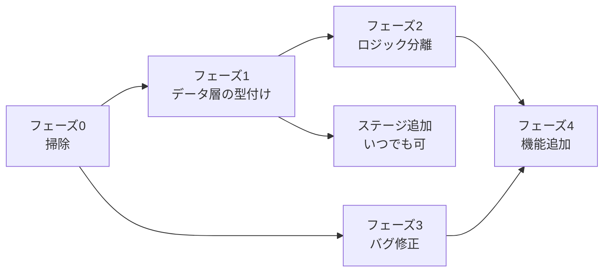

# 07. 整理ロードマップ（`plus` ブランチ）

**目的**: 「ステージ / ギミック / 画面の追加を AI 主導で安全に回せる」状態にすること。
グラフィックは完成しているので、**触るのはロジックとデータ構造だけ**。

## 進め方の原則

- **1 フェーズ = 1 まとまりのコミット**。フェーズをまたいだ変更を混ぜない。
- 各フェーズの完了条件を満たすまで次へ進まない。
- **ルールやデータ形式を変えたら、同じコミットで `dev-docs/` を更新する。**
- 変更のたびに `./node_modules/.bin/tsc --noEmit` を通す。
- `docs/` は最後にまとめて `bun run build` で更新する。作業中は触らない。

## 依存関係



**ステージ追加だけはフェーズ 1 が終われば独立して進められる。**
ギミック追加はフェーズ 2 の後にすると劇的に楽になる。

---

## フェーズ 0 — 掃除（半日 / リスク極小）

**目的**: ノイズを消して、以降の差分を読みやすくする。挙動は 1 ミリも変えない。

- [x] `CLAUDE.md` と `dev-docs/` を追加する
- [ ] `console.log(this.currentData)` を消す（[Z-8](06-known-issues.md)）
- [ ] `src/styles.css` を削除し、`index.html` の `<link>` も消す（[Z-1](06-known-issues.md)）
- [ ] `Node` クラス、`addTile()` の空 `if` 4 つ、空の `Laser.update()` を削除（[Z-2](06-known-issues.md) / [Z-3](06-known-issues.md) / [Z-4](06-known-issues.md)）
- [ ] 未使用の `hasAdjacentTile()` は残す（将来使う）が、`gridToWorld()` は `StageView` から実際に使うよう置き換える（[Z-6](06-known-issues.md)）
- [ ] `tsconfig.json` の `noUnusedLocals` / `noUnusedParameters` を `true` にして、出てきた警告を潰す（[Z-14](06-known-issues.md)）
- [ ] `R` リセットに `this.time = 70;` を足す（[R-1](06-known-issues.md)）
- [ ] `R` の判定を WASD の走査から独立させる（[I-1](06-known-issues.md)）

**完了条件**: `tsc --noEmit` が通り、全 7 ステージを通しでクリアできる。

---

## フェーズ 1 — データ層の型付けと明示化（1 日 / リスク小）

**目的**: **ステージを AI が安全に追加できる状態を作る。** ここが最優先。

- [ ] `src/game/stage/stagedata.ts` を作り、ステージ JSON の型を定義する

```ts
export type StageObjectData =
  | { type: "laser"; id: string; position: { x: number; y: number } };

export interface StageData {
  steps?: number;
  tiles: string[];
  objects?: StageObjectData[];
}
```

- [ ] `src/game/stage/stages/index.ts` を作り、**明示的な import の配列**にする（[O-1](06-known-issues.md) / [J-1](06-known-issues.md) を同時に解消）

```ts
import type { StageData } from "../stagedata";
import stage1 from "./stage1.json";
import stage2 from "./stage2.json";
// …

export const stages: StageData[] = [stage1, stage2, /* … */];
```

- [ ] `stage.ts` の `import.meta.glob` を上記に差し替え、`currentData: StageData|null` に型を付ける（[Z-11](06-known-issues.md)）
- [ ] 開発時のみ動くバリデータ `validateStage(data, name)` を追加する
  - `S` がちょうど 1 個ある
  - `G` が 1 個以上ある
  - `x=0` の列と `y=0` の行にタイルがある（[F-1](06-known-issues.md) 対策）
  - 幅 ≤ 21・高さ ≤ 12
  - `objects[].position` が「片方だけ半整数」
  - レーザーの `id` に対応するスイッチがあるか（無ければ警告のみ）
  - `import.meta.env.DEV` のときだけ実行し、問題は `console.warn` で出す
- [ ] Text スタイルを `src/common/text.ts` に共通化する（[Z-9](06-known-issues.md)）

**完了条件**: 存在しないステージ文字や不正なレーザー座標を書くと、
`bun run dev` の起動時に警告が出る。`tsc --noEmit` が通る。

> **このフェーズが終わった時点で、「ステージを 10 個追加して」を AI に任せられるようになる。**

---

## フェーズ 2 — ロジックの分離（2〜3 日 / リスク中）

**目的**: **ギミックを追加できる状態を作る。** タイルとオブジェクトの振る舞いを多態にする。

- [ ] `Tile` に `canEnter()` / `enter()` を導入し、`state.value` の直接操作を 5 箇所から排除
      （[04-recipes.md レシピ A-1](04-recipes.md#a-1-まず基底-tile-に判定メソッドを生やす初回だけ)）
- [ ] `field.ts` (316 行) を分割する

```
src/game/stage/
  field.ts          … Field クラスのみ
  tiles/
    tile.ts         … Tile 基底 + TileState
    start.ts        … StartTile
    end.ts          … EndTile
    switch.ts       … SwitchTile
    index.ts        … 文字 → クラスのレジストリ
  objects/
    object.ts       … StageObject 基底
    laser.ts        … Laser
```

- [ ] 文字 → タイルの対応を `stage.ts` の `switch` からレジストリへ移す

```ts
// tiles/index.ts
export const tileRegistry: Record<string, (x: number, y: number) => Tile> = {
  'S': (x, y) => new StartTile(TileState.Unused, x, y),
  'G': (x, y) => new EndTile(TileState.Unused, x, y),
  '#': (x, y) => new Tile(TileState.Unused, x, y),
  '@': (x, y) => new Tile(TileState.Used, x, y),
};
```

  → **以降、新しいタイルの追加はこの表に 1 行足すだけになる。**
- [ ] オブジェクトも同様に `objectRegistry` にして `Stage.reset()` の `switch` を消す
- [ ] `Entity` に `target` / `gap` / `size` / `move()` / `update()` を集約し、
      `Player` と `Ghost` の重複を解消（[Z-10](06-known-issues.md)）
- [ ] `grid` / `start` のオブジェクト共有を解消（[E-1](06-known-issues.md)）
- [ ] `next()` のゴール判定に `e instanceof Player` を足す（[X-1](06-known-issues.md)）
- [ ] ゴーストの移動先を検証してから `next()` に渡す（[X-2](06-known-issues.md)）
- [ ] `Field.nextTurn()` を追加し、`StageLogic.loop()` から呼ぶ
      （[04-recipes.md レシピ B-2](04-recipes.md#b-2-ターン経過フックを用意する初回だけ)）
- [ ] `Stage` (150 行) の責務を分ける
  - `StageLoader` … `StageData` の解決と検証
  - `StageBuilder` … `StageData` → `Field` / `Player` / `Ghost` の構築
  - `Stage` … シーンとしての振る舞いとループ管理のみ

**完了条件**: 新しいタイル 1 種類を、`tiles/` にファイルを 1 つ足して
レジストリに 1 行書くだけで追加できる。全 7 ステージが従来どおり解ける。

---

## フェーズ 3 — バグ修正と堅牢化（1〜2 日 / リスク中）

**目的**: 公開できる品質にする。**ステージの解き味が変わるので、必ず全ステージを検証する。**

- [ ] `isJammed` のレーザー判定を修正（[L-1](06-known-issues.md)）
- [ ] フィールドのセンタリングに `aabb.min` を反映（[F-1](06-known-issues.md)）
- [ ] `StageView` の 0 除算にガードを入れる（[V-1](06-known-issues.md)）
- [ ] `Stage.reset()` の `destroy()` を計測し、必要なら `{ children: true }` にする（[S-1](06-known-issues.md)）
- [ ] 補間に `Ticker.deltaTime` を反映させる（[Z-13](06-known-issues.md)）。
      係数は `1 - Math.pow(1 - k, t.deltaTime)` の形にすると見た目を保てる
- [ ] **ヘッドレスなソルバを書く**（[Z-15](06-known-issues.md)）
  - `StageData` を入力に、描画抜きでルールだけをシミュレートして「解が存在するか」「最短ループ数」を返す
  - 全ステージに対して CI 的に回せば、ルール変更の回帰を検出できる
  - **これがあると AI によるステージ量産の検証が自動化できる。費用対効果が最も高い項目**

**完了条件**: 全ステージがソルバで「解あり」と判定される。手動でも全クリアできる。

---

## フェーズ 4 — 機能追加（`plus` の本体）

フェーズ 2 と 3 が終わってから着手する。優先順は好みで入れ替えてよい。

- [ ] **複数ゴースト対応**（[G-1](06-known-issues.md)）。`Ghost.rewind()` を作り `maxGhosts` を実質的に有効化する。
      パズルの表現力が一段上がる、最も価値の高い拡張
- [ ] **`Scene` の入退場フック**（[C-1](06-known-issues.md)）。`enter()` / `exit()` を `Game.setScene()` から呼ぶ
- [ ] **ステージセレクト画面**（[04-recipes.md レシピ C](04-recipes.md#レシピ-c-新しい画面シーンを追加する)）
- [ ] **進捗の保存**（[04-recipes.md レシピ E](04-recipes.md#レシピ-e-進捗を保存する)）。README の注意書きを 1 つ消せる
- [ ] **効果音**（[04-recipes.md レシピ F](04-recipes.md#レシピ-f-効果音を足す)）
- [ ] **新ギミック**。案:
  - 複数回通れるタイル（[04-recipes.md レシピ A](04-recipes.md#レシピ-a-新しいタイルを追加する) がそのまま実装）
  - ターンで点滅するレーザー（[04-recipes.md レシピ B](04-recipes.md#レシピ-b-新しいオブジェクトギミックを追加する) がそのまま実装）
  - 一方通行タイル（進入方向を制限）
  - ゴーストの実体歩数を増減させるアイテム（「歩数の保存則」を崩す仕掛け）
  - トグルスイッチ（押すたびに ON/OFF が反転する。現状は押しっぱなし）
- [ ] **ステージ追加**（8 以降）。フェーズ 1 完了後ならいつでも並行して進められる

---

## AI に作業を任せるときの粒度

| 依頼の粒度 | 例 | 前提 |
|---|---|---|
| ◎ 任せやすい | 「ステージを 5 個追加。ギミックはレーザーとスイッチのみ、steps は 6〜10」 | フェーズ 1 完了 |
| ◎ 任せやすい | 「[04-recipes.md](04-recipes.md) のレシピ A に従って一方通行タイルを追加」 | フェーズ 2 完了 |
| ○ 任せられる | 「フェーズ 0 のチェックリストを全部やって」 | — |
| ○ 任せられる | 「[06-known-issues.md](06-known-issues.md) の L-1 を直して、全ステージが解けるか確認」 | フェーズ 3 |
| △ 相談しながら | 「フェーズ 2 の `field.ts` 分割」 | 設計判断が入る |
| ✕ 任せにくい | 「面白いステージを作って」 | 面白さの基準が言語化されていない |

**依頼するときは必ず「どの文書のどの節に従うか」を明示すること。**
これがこの文書群を用意した最大の理由。

---

## 公開の段取り

- GitHub Pages は `docs/` を配信元にしている（[vite.config.ts](../vite.config.ts) の `build.outDir`）。
- `plus` の内容を公開するには、次のどちらか:
  1. `plus` が安定した時点で `main` にマージし、`bun run build` して `docs/` を更新する（推奨）
  2. GitHub の Pages 設定で配信ブランチを `plus` に切り替える（先行公開したい場合）
- **`docs/` を含むコミットは差分が大きくノイズになる。** 公開のタイミングでまとめて 1 コミットにする。
- 公開前に [README.md](../README.md) の注意書き（「リロードで進捗リセット」など）を実態に合わせて更新する。
