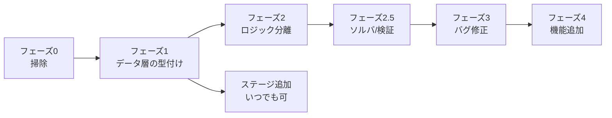

# 07. 整理ロードマップ（`plus` ブランチ）

**目的**: 「ステージ / ギミック / 画面の追加を AI 主導で安全に回せる」状態にすること。
グラフィックは完成しているので、**触るのはロジックとデータ構造だけ**。

## 現在地

| フェーズ | 状態 |
|---|---|
| 0 掃除 | ✅ 完了 |
| 1 データ層の型付け | ✅ 完了 |
| 2 ロジックの分離 | ✅ 完了 |
| 2.5 ソルバと検証 | ✅ 完了 |
| 3 バグ修正 | ✅ 完了（描画の目視確認だけ残っている） |
| 4 機能追加 | 🔶 進行中（4a UX 改善セット / 4b 複数ゴースト 完了） |

**土台は完成している。** 以降は `bun run verify` を受け入れ基準にして、
ステージ・ギミック・画面をどんどん足していけばよい。

## 進め方の原則

- **1 フェーズ = 1 まとまりのコミット**。フェーズをまたいだ変更を混ぜない。
- 各フェーズの完了条件を満たすまで次へ進まない。
- **ルールやデータ形式を変えたら、同じコミットで `dev-docs/` を更新する。**
- 変更のたびに `./node_modules/.bin/tsc --noEmit` を通す。
- `docs/` は最後にまとめて `bun run build` で更新する。作業中は触らない。

## 依存関係と実施順

**ステージ追加だけはフェーズ 1 が終われば独立して進められる。**
ギミック追加はフェーズ 2 の後にすると劇的に楽になる。

> **実施順の変更（2026-09-03）**: 当初フェーズ 3 の一項目だった「ヘッドレスソルバ」を
> **フェーズ 2.5 として独立させ、バグ修正より前に持ってきた**。
> 挙動を変える修正（L-1 / F-1）を入れる前に自動検証を用意しておかないと、
> 全ステージの手動通しプレイでしか回帰を検出できないため。
> ソルバはフェーズ 2 でロジックが描画から分離されて初めて安く作れるので、
> 2 → 2.5 → 3 の順が最も効率がよい。

---

## フェーズ 0 — 掃除 ✅ 完了

**目的**: ノイズを消して、以降の差分を読みやすくする。挙動はほぼ変えない。

- [x] `CLAUDE.md` と `dev-docs/` を追加する
- [x] `console.log(this.currentData)` を消す（Z-8 解消）
- [x] `src/styles.css` を削除し、`index.html` の `<link>` も消す（Z-1 解消）
- [x] `Node` クラスと `addTile()` の空 `if` 4 つを削除（Z-2 / Z-3 解消）
- [x] `gridToWorld()` を `StageView` から実際に使うよう置き換える（Z-6 の半分を解消）
- [x] `R` リセットに `this.time = 70;` を足す（R-1 解消）
- [x] `R` の判定を WASD の走査から独立させる（I-1 解消）
- [x] `loop()` の未使用ローカル `input` を削除

**判断メモ**:

- **`Laser.update()` は削除せず残した**（Z-4 は「解消しない」で確定）。
  [04-recipes.md レシピ B](04-recipes.md#レシピ-b-新しいオブジェクトギミックを追加する) で
  毎フレーム更新するギミックの拡張点として使うため。意図が伝わるようコメントを付けた。
- **`hasAdjacentTile()` も残した。** 将来の一方通行タイル等で使う。
- **`noUnusedLocals` の有効化はフェーズ 3 に移した。**
  有効にすると [L-1](06-known-issues.md) の未使用 `lx`/`ly` が即エラーになり、
  「挙動を変えない」というフェーズ 0 の前提を破るため。L-1 を直すのと同じコミットで入れる。

**完了条件**: `tsc --noEmit` が通る ✅ / `vite build` が通る ✅

---

## フェーズ 1 — データ層の型付けと明示化 ✅ 完了

**目的**: **ステージを AI が安全に追加できる状態を作る。**

- [x] [src/game/stage/stagedata.ts](../src/game/stage/stagedata.ts) にステージ JSON の型と定数を定義
      （`StageData` / `DEFAULT_STEPS` / `MAX_COLUMNS` / `MAX_ROWS` / `OBJECT_TYPES` / `PERMANENT_WALL_ID`）
- [x] [src/game/stage/stages/index.ts](../src/game/stage/stages/index.ts) を作り、
      `import.meta.glob` を**明示的な import の配列**に置き換え（O-1 / J-1 解消）
- [x] `stage.ts` の `currentData` に `StageData|null` の型を付け、`any` を排除（Z-11 解消）
- [x] `S` が無い場合に落ちる問題を解消（`(0,0)` フォールバック + エラーログ）
- [x] [src/game/stage/validate.ts](../src/game/stage/validate.ts) に `validateStage()` を追加
- [x] `bun run verify` で全ステージを検証できるようにした（[scripts/verify.ts](../scripts/verify.ts)）
- [x] 開発サーバ起動時にも同じ検証が走るようにした（`import.meta.env.DEV`）
- [x] Text スタイルを [src/common/text.ts](../src/common/text.ts) の `bodyTextStyle` に共通化（Z-9 解消）

**判断メモ**:

- **`StageObjectData.type` は `string` のままにした。**
  JSON は外部データなので `"laser"` のリテラル型で受けると型が合わず、
  結局キャストが必要になる。境界で `validateStage()` が絞り込む方針にした。
- **恒久的に消せないレーザーの表現として `id: "-"` を導入した**（`PERMANENT_WALL_ID`）。
  これが無いと「対応スイッチが無いレーザー」を検証時に typo と区別できない。
- `src/vite-env.d.ts` を追加して `import.meta.env` に型を付けた。

**完了条件**: `bun run verify` が全ステージ OK ✅ / `tsc --noEmit` が通る ✅ / `vite build` が通る ✅

> **この時点で「ステージを 10 個追加して」を AI に任せられる。**
> ただし「本当に解けるか」はまだ機械では検証できない（フェーズ 2.5 で解消）。

---

## フェーズ 2 — ロジックの分離 ✅ 完了

**目的**: **ギミックを追加できる状態を作る。** そして**ルールを描画と入力から切り離す**。

- [x] `Tile` に `canEnter()` / `onEnter(solid)` / `isGoal` を導入し、`state.value` の直接操作を排除
- [x] `field.ts` (292 行) を分割
  - [direction.ts](../src/game/stage/direction.ts) … `Direction` と方向計算
  - [tiles.ts](../src/game/stage/tiles.ts) … `Tile` 系 + `tileRegistry`
  - [field.ts](../src/game/stage/field.ts) … `Field` のみ（139 行）
- [x] 文字 → タイルを `tileRegistry` / `createTile()` に移した（**追加は 1 行**）
- [x] オブジェクトも `objectRegistry` / `createObject()` にして `Stage.reset()` の `switch` を削除
- [x] `Entity` に `target` / `size` / `move()` / `update()` / `bump()` を集約（Z-10 解消）
- [x] `grid` / `start` のオブジェクト共有を解消。`start` は誰も読まないので削除（E-1 / Z-7 解消）
- [x] `next()` のゴール判定に `e instanceof Player` を追加（X-1 解消）
- [x] ゴーストの移動先が無い場合のガードを追加（X-2 解消）
- [x] `Field.nextTurn()` と `Laser.onTurn()` を追加（ターン駆動ギミックの拡張点）
- [x] **`StageLogic` から PixiJS と入力への依存を除去**
  - `Stage` への直接参照をやめ、`StageContext` インターフェース経由に
  - キー入力を [`KeyboardInput`](../src/game/stage/stageinput.ts) に分離
  - `tryMove(dir)` / `requestReset()` という明示的な API に

**判断メモ**:

- **`SwitchTile` から `Field` への参照を切った。** スイッチ→レーザーの結線は `Field.addTile()` が行う。
  これで `tiles.ts` と `field.ts` の循環参照が無くなり、レジストリが純粋な関数で書けるようになった。
- **`Stage` の 3 分割（Loader / Builder / Stage）は見送った。**
  `StageContext` の導入でルールが独立したことで当初の目的は達成でき、
  残った `Stage` は 165 行で「データからシーングラフを組む」だけになったため。
  さらに膨らんだら分割する。
- **タイルの見た目（`Graphics`）はタイルクラスに残した。**
  モデルとビューを完全に分けると、タイル 1 種類ごとに 2 クラス書くことになり、
  「レジストリに 1 行」という目標と逆行する。PixiJS の `Graphics` は
  描画コンテキスト無しでも構築できるので、分けなくてもヘッドレスで動く。

**完了条件**: 新しいタイルは `tiles.ts` にクラスを 1 つ + レジストリに 1 行で追加できる ✅ /
`tsc --noEmit` ✅ / `vite build` ✅ / 全 7 ステージが解ける ✅（フェーズ 2.5 で自動検証）

---

## フェーズ 2.5 — ヘッドレスソルバと検証 ✅ 完了

**目的**: **ステージが解けるかを自動で検証できるようにする。**

- [x] [solver.ts](../src/game/stage/solver.ts) の `Sim` が `StageContext` を実装
  - **ルールを一切再実装していない。** ゲーム本体と同じ `StageLogic` / `Field` / `Tile` / `Ghost` を動かす
  - 演出時間は `deltaTime: 100` の擬似 `Ticker` で飛ばす
- [x] ループ数について反復深化する DFS ソルバ（状態の指紋で重複除去、探索予算つき）
- [x] `bun run verify` がデータ検証 + 解の存在確認を行う
- [x] 既存 7 ステージの**最小ループ数を `EXPECTED_LOOPS` に固定**（回帰検出用）

**結果**（全 7 ステージ、約 1 秒）:

| # | 最小ループ数 | 手順 |
|---|---:|---|
| 1 | 1 | `DDDD` |
| 2 | 2 | `AAAADDDD` |
| 3 | 2 | `DDDWADS` |
| 4 | 2 | `SDWDSAA` |
| 5 | 2 | `DSSDWDSDDDDDDDDDD` |
| 6 | 2 | `DSSDDWWADSSDSS` |
| 7 | 4 | `DWWDDDDSSADSSSDDWDWWDDDDSSADDD` |

> ステージ 2 の `AAAADDDD` は [02-game-rules.md](02-game-rules.md) で手で導いた解法と一致した。
> リファクタでルールが壊れていないことの裏付けになっている。

**完了条件**: `bun run verify` が全ステージ緑 ✅

---

## フェーズ 3 — バグ修正と堅牢化 ✅ 完了

**目的**: 公開できる品質にする。挙動が変わる修正なので、すべて `bun run verify` で検証した。

- [x] `isJammed()` を `existsLaser()` を使う形に書き直し（L-1 解消）
  - **全ステージの最小ループ数は変化なし。** ステージ 4 と 7 の最短手順だけが短くなった
- [x] `noUnusedLocals: true`（Z-14 の半分。未使用 import 3 つを削除）
- [x] センタリングに `aabb.min` を反映（F-1 解消）
  - **副産物**: 左詰め・上詰めの制約が不要になったので、`validateStage()` からその検査を削除した
- [x] `StageView` の 0 除算にガード（V-1 解消）
- [x] `Stage.reset()` の破棄を作り直しの**最後**に移し `{ children: true }` に（S-1 解消）
  - 先に破棄すると、ゴーストの生成元になる旧 `player` まで壊れるため順序が重要
  - `StageView` が生き残るゴーストを新しいツリーへ付け替えた後なので、残りは捨てて安全
- [x] UI の残歩数ドットのテクスチャを使い回すよう変更（ループのたびに `generateTexture` していた）
- [x] 補間を `damp()`（[interpolate.ts](../src/common/interpolate.ts)）経由にしてフレームレート非依存に（Z-13 解消）
  - 60fps では係数がそのまま使われるので**見た目は変わらない**

**検証**:

- `bun run verify` 全ステージ緑（最小ループ数 1/2/2/2/2/2/4 は修正前後で不変）
- 破棄順の不変条件（生き残るゴーストが壊れないこと）をヘッドレスで確認
- センタリングが左右上下の空きに依らず `(640, 360)` になることをヘッドレスで確認

> ⚠️ **描画まわりは実際にプレイしての確認が残っている。**
> `bun run dev` で 1 周プレイし、タイルのせり上がり・ゴーストの明滅・
> ループを何度も回したときの表示崩れが無いかを見ること。

---

## フェーズ 4 — 機能追加（`plus` の本体）

### 4a. UX 改善セット ✅ 完了

- [x] `Scene` に `enter()` / `exit()` を追加し `Game.setScene()` から呼ぶ（C-1 解消）
- [x] 進捗の永続化（[progress.ts](../src/common/progress.ts)）。クリア記録とイベント再生記録を localStorage へ
- [x] **ステージ選択画面**（[src/game/select/](../src/game/select/)、書式は [08-select-format.md](08-select-format.md)）
  - ボタンの一覧ではなく、**ステージと同じグリッドを歩き回るワールドマップ**
  - `&` タイルに立つとステージ番号（`1-1`）が自機の上に出る
  - `&` の隣の赤い三角の向きへ動くとステージへ入る。マーカーのマスは描画されない
  - ステージのラベルは `world` と `exits` の並び順から自動生成。**10 個以上でも破綻しない**
  - クリアするとその `&` の上に戻ってくる
  - 進行のロックはソフトウェアではなく**マップの地形**（壁・レーザー）で行う
  - クリア状況で発動する `events` と、**そのギミックへのカメラフォーカス演出**
- [x] シーン間の遷移を `Game` に集約（`openSelect` / `playStage` / `returnToSelect`）。
      シーン同士が互いを import しない形にした
- [x] `bun run verify` を選択マップにも拡張
  - データ検証に加えて、**地形ロックで詰まないか**を解析（[reachability.ts](../src/game/select/reachability.ts)）
  - どの選択マップからも入れないステージがあれば落ちる

**判断メモ**:

- **マップの読み方（`resolveSelectMap`）を純粋関数に切り出した。**
  シーンと検証の両方がこれを使うので、「マップの解釈」がひとつしか存在しない。
- **選択画面のタイルはステージの `Tile` を継承している。** 違いは
  `onEnter()` を空にした `FreeTile` だけ。`Field` / 座標変換 / 入退場アニメがそのまま使える。
- **入退場アニメを `fieldanim.ts` に切り出した**（`applyWave` / `entityAlpha`）。
  ステージと選択画面で同じ波が使える。
- **ステージ番号ラベルだけは描画規約の例外**（黒地に白文字・影なし）。
  読みやすさを優先した意図的な逸脱で、[08-select-format.md](08-select-format.md) に明記した。

> ⚠️ **描画は未確認。** `bun run dev` で
> タイトル → 選択画面 → ステージ → クリア → 選択画面 を 1 周し、
> 矢印の向き・ラベルの位置・3 ステージクリア後のゲート開放演出を目視してください。

### 4b. 複数ゴースト ✅ 完了

- [x] `Ghost.rewind()` を追加し、生成時の状態（開始位置・コマンド列・実体歩数）へ毎ループ巻き戻す（G-1 解消）
- [x] ゴーストの体数を**ステージごと**に指定できるようにした（`stages/*.json` の `ghosts`、既定 1、上限 4）
- [x] `Stage.reset()` と `Sim.build()` の両方で同じ手順（`shift` → `push` → 全員 `rewind`）を踏む
- [x] `bun run verify` の出力に `ghosts=N` を表示
- [x] **ステージ 8** を追加。2 つのスイッチを 2 体のゴーストで同時に押さえ続ける（1-8）

**判断メモ**:

- **`MAX_GHOSTS` をグローバルに増やすのではなく、ステージごとの `ghosts` にした。**
  グローバルに増やすと既存 8 ステージの難易度が全部変わってしまう。
  ギミックのつまみとして扱うほうが、ステージ設計の自由度も高い。
- ステージ 8 は**ソルバでゴースト 1 体では解けないことを確認済み**（58 状態を探索し尽くして解なし）。
  新しい仕掛けが本当に必要な設計になっている。
  手順は `KNOWN_ROUTES` に固定してあるので、`rewind()` が壊れると `bun run verify` が落ちる。

### 4c. 残り
- [ ] **効果音**（[04-recipes.md レシピ F](04-recipes.md#レシピ-f-効果音を足す)）
- [ ] **新ギミック**。案:
  - 複数回通れるタイル（[レシピ A](04-recipes.md#レシピ-a-新しいタイルを追加する) がそのまま実装）
  - ターンで点滅するレーザー（[レシピ B](04-recipes.md#レシピ-b-新しいオブジェクトギミックを追加する) がそのまま実装）
  - 一方通行タイル（進入方向を制限）
  - ゴーストの実体歩数を増減させるアイテム（「歩数の保存則」を崩す仕掛け）
  - トグルスイッチ（押すたびに ON/OFF が反転する。現状は押しっぱなし）
- [ ] **選択画面のギミック**。`events` の `action` を増やす（タイルの出現、ワープなど）
- [ ] **ワールド 2 以降**と、ワールド間の導線
- [ ] **ステージ追加**。追加したら選択マップの `exits` にも足すこと（verify が検出する）
- [x] README の「リロードで進捗がリセット」の記述を修正
  - ただし README は作者の文章なので、`plus` 公開時に自分の言葉で書き直すこと

---

## AI に作業を任せるときの粒度

| 依頼の粒度 | 例 |
|---|---|
| ◎ 任せやすい | 「ステージを 5 個追加。ギミックはレーザーとスイッチのみ、steps は 6〜10、最小 2 ループで解けること」 |
| ◎ 任せやすい | 「[04-recipes.md](04-recipes.md) のレシピ A に従って一方通行タイルを追加」 |
| ◎ 任せやすい | 「[06-known-issues.md](06-known-issues.md) の G-1 を直して複数ゴーストを有効にして」 |
| ○ 任せられる | 「フェーズ 4 のステージセレクト画面を作って」 |
| △ 相談しながら | 「難易度カーブを見直して既存ステージを組み直して」 |
| ✕ 任せにくい | 「面白いステージを作って」（面白さの基準が言語化されていない） |

**受け入れ基準は `bun run verify` が緑であること。**
ステージ量産を頼むときは「最小ループ数」も条件に入れると難易度を指定できる。

**依頼するときは必ず「どの文書のどの節に従うか」を明示すること。**
これがこの文書群を用意した最大の理由。

---

## 公開の段取り

- GitHub Pages は `docs/` を配信元にしている（[vite.config.ts](../vite.config.ts) の `build.outDir`）。
- `plus` の内容を公開するには、次のどちらか:
  1. `plus` が安定した時点で `main` にマージし、`bun run build` して `docs/` を更新する（推奨）
  2. GitHub の Pages 設定で配信ブランチを `plus` に切り替える（先行公開したい場合）
- **`docs/` を含むコミットは差分が大きくノイズになる。** 公開のタイミングでまとめて 1 コミットにする。
- 公開前に [README.md](../README.md) の注意書き（「リロードで進捗リセット」など）を実態に合わせて更新する。
