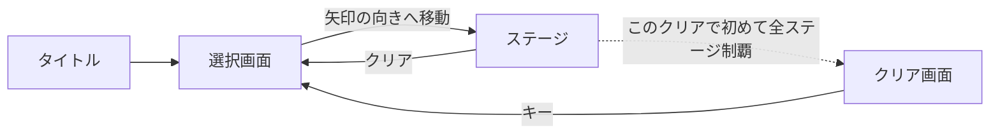

# 08. ステージ選択画面（ワールドマップ）の仕様

選択画面は**ボタンの一覧ではなく、ステージと同じグリッドを歩き回るマップ**。
`&` タイルに立つとステージ番号が出て、隣の赤い矢印の向きへ動くとそのステージへ入る。

対象: [src/game/select/maps/](../src/game/select/maps/) 配下の `*.json`。
実装は [src/game/select/](../src/game/select/)。

## 1. ステージとの違い

| | ステージ | 選択画面 |
|---|---|---|
| タイル | 踏むと `Used`（一筆書き） | **消費されない**。何度でも通れる |
| 歩数制限 | あり | なし |
| ゴースト | いる | いない |
| 詰み・リセット | あり | なし |
| 進行の制限 | 歩数と一筆書き | **マップの地形**（壁・レーザー・スイッチ・隠し床） |
| カメラ | 固定（中央） | ふだん中央。イベント演出とスイッチを踏んだときだけ寄る |

**タイル・レーザー・フィールド・座標変換・入退場アニメはステージと同じものを使い回している。**
違うのは `Tile.onEnter()` を空にした [`FreeTile`](../src/game/select/selecttiles.ts) と、
それを土台にした選択画面専用のタイル（`SelectSwitchTile` / `HiddenTile`）だけ。

## 2. スキーマ

```jsonc
{
  "world": 1,                 // 必須。ラベルの左側の数字
  "tiles": [                  // 必須。1 要素 = 1 行
    " 1 2 3 ",
    "S&#&#&#"
  ],
  "exits": [                  // 必須。**この並び順がステージ番号になる**
    { "mark": "1", "stage": 0 },   // → 1-1
    { "mark": "2", "stage": 1 },   // → 1-2
    { "mark": "3", "stage": 2 }    // → 1-3
  ],
  "objects": [                // 省略可。ステージとまったく同じ書式
    { "type": "laser", "id": "g", "position": { "x": 6.5, "y": 1 } }
  ],
  "events": [                 // 省略可。クリア状況で発動するギミック
    {
      "id": "world1-gate",
      "when": { "clearedCount": 3 },
      "action": { "type": "openLaser", "id": "g" }
    }
  ]
}
```

スイッチと隠し床を使う例:

```jsonc
"tiles": [
  " 1  2",
  "S&#A&",     // A = 隠し床。1-1 をクリアすると現れる
  "  a  "      // a = スイッチ。踏むとレーザー a が止まる
],
"objects": [ { "type": "laser", "id": "a", "position": { "x": 2.5, "y": 1 } } ],
"events": [
  { "id": "world1-bridge", "when": { "cleared": "1-1" }, "action": { "type": "revealTiles", "id": "A" } }
]
```

型は [selectdata.ts](../src/game/select/selectdata.ts)。

## 3. `tiles` の記法

**ステージとは別の記法。** レジストリは
[selecttiles.ts](../src/game/select/selecttiles.ts) の `selectTileRegistry`。

| 文字 | 意味 |
|---|---|
| `S` | スタート（**必須・1 個**）。初回はここから始まる |
| `#` | 通常の足場。何度でも通れる |
| `&` | **ステージ入口のタイル。** ここに立つとステージ番号が出る |
| `@` | 壁。通れない |
| `a`〜`z` | **スイッチ。** 踏むと同じ id のレーザーが恒久的に止まる（§6.1） |
| `A`〜`Z`（`S` を除く） | **隠し床。** 最初は見えず通れない。同じ文字の `revealTiles` イベントで現れる（§6） |
| `exits[].mark` の文字 | **描画されないマーカー。** 入口の向きとステージを決めるためだけに置く |
| 半角スペース | 何も無い |

### `&` とマークの関係

```
 tiles:  " 1 "        1 = マーク（描画されない）
         "S& "        & = 立つ場所
```

- マークの**隣接 4 方向**から `&` を探し、`&` → マークの向きが「入口へ進む向き」になる。
- その 2 マスの**中間に赤い三角の矢印**が自動で描かれる（レーザーと同じ半整数座標）。
- `&` に立つと、自機の上にステージ番号（`1-1` など）が出る。
- 矢印の向きへ動くと、そのステージへ入る。**マークのマスには乗らない。**

## 4. ステージ番号と 10 個以上への対応

**ラベルは `world` と `exits` の並び順から自動生成される。**

```
world: 1, exits[0] → "1-1"
world: 1, exits[1] → "1-2"
world: 2, exits[0] → "2-1"
```

`mark` の文字とラベルの数字は**無関係**。
そのため 10 個以上のステージがあるワールドでも問題なく書ける。

| ステージ数 | 書き方 |
|---|---|
| 9 個まで | `mark` に `1`〜`9` を使うのが読みやすい |
| 10 個以上 | `mark` に記号（`*` `+` `%` `?` `!` `<` `>` など）を使う。ラベルは `1-10`, `1-11`, … と自動で続く |
| もっと増える | ワールドを分ける。`world2.json` を作って [maps/index.ts](../src/game/select/maps/index.ts) に足す |

**`mark` に使えない文字**: `S` `#` `&` `@`（タイル記法）、`a`〜`z`（スイッチ）、
`A`〜`Z`（隠し床）、半角スペース。
`bun run verify` が重複を検出する。

## 5. 進行のロック

ソフトウェア的なロック（「未クリアだから入れない」）は**しない**。
代わりに**マップの地形**で制御する。

```jsonc
// 3 ステージクリアするまで先へ進めない関所
"objects": [
  { "type": "laser", "id": "g", "position": { "x": 6.5, "y": 1 } }
],
"events": [
  { "id": "world1-gate", "when": { "clearedCount": 3 }, "action": { "type": "openLaser", "id": "g" } }
]
```

- レーザーは選択画面では「通せんぼ」。ぶつかっても何も起きず、単に進めない。
- 壁 `@` や、スイッチ `a`〜`z` によるパズルも置ける。
- **道そのものを隠しておき、クリアで出す**こともできる（隠し床と `revealTiles`）。

## 6. `events`（クリア状況で発動するギミック）

```jsonc
{
  "id": "world1-gate",                          // 必須・マップ内で一意
  "when": { "clearedCount": 3 },                // 発動条件
  "action": { "type": "openLaser", "id": "g" }, // 効果
  "focus": { "x": 6.5, "y": 1 }                 // 省略可。カメラを寄せる位置
}
```

### `when`（両方書いたら AND）

| キー | 意味 |
|---|---|
| `clearedCount` | クリア済みステージ数がこれ以上 |
| `cleared` | このラベルをクリア済み（文字列 or 文字列の配列） |

### `action`

| `type` | 効果 |
|---|---|
| `openLaser` | `id` のレーザーを恒久的に止める |
| `revealTiles` | `id`（大文字 1 文字）の隠し床をすべて出す |

`revealTiles` のカメラは、`focus` を省略すると**現れる床の重心**へ寄る。
床は「すでに歩ける床に接するマス」から順に 1 マスずつ遅れて現れ、道が伸びていくように見える
（[selecttiles.ts](../src/game/select/selecttiles.ts) の `revealOrder()`）。

新しい `action` を足すときは
[selectdata.ts](../src/game/select/selectdata.ts) の `SELECT_ACTION_TYPES` にも足すこと。

### 演出

条件を満たしたイベントは、選択画面に**入った直後に 1 度だけ**演出付きで再生される。

```
0    カメラが対象（focus、省略時は action の対象レーザー）へ寄り始める
40   効果が適用される（レーザーが消える）
95   カメラが中央へ戻り始める
140  操作可能に戻る
```

再生済みかどうかは `id` で `localStorage` に記録される
（[progress.ts](../src/common/progress.ts)）。
**すでに演出済みのイベントは、次回以降は効果だけ静かに適用される。**
`id` を変えると演出がもう一度流れる。

### 6.1 マップ上のスイッチ

スイッチ `a`〜`z` を**初めて**踏むと、イベントと同じ演出（カメラが対応するレーザーへ寄り、
レーザーが止まり、戻ってくる）が流れる。データに `events` を書く必要は無い。

- 押したことは `world<N>-switch-<id>`（例 `world1-switch-a`）という id で
  イベントの再生記録と同じ場所に保存される。次からは押された状態で始まる。
- スイッチに対応するレーザーが無いと `bun run verify` が落ちる（踏んでも何も起きないため）。
- **ステージのスイッチとは別物。** 踏んでも `Used` にならず、ループも無いので戻らない。

## 7. 画面遷移



遷移はすべて [`Game`](../src/game/game.ts) が仲介する（`openSelect` / `playStage` / `returnToSelect` / `leaveFin`）。
**シーン同士は互いを import しない。** 循環参照を避けるための決まり。

クリアすると、そのステージの `&` タイルの上に立った状態で選択画面へ戻る。
クリア画面に行くのは**最後の 1 ステージをクリアしたときの 1 回だけ**。
全クリア後に遊び直したステージをクリアしても、選択画面へ戻る。
クリア画面でキーを押すと、最後にクリアしたステージの `&` の上へ戻る。

## 8. 検証

```bash
bun run verify
```

選択マップについて次を検査する。

- `world` が 1 以上の整数 / `S` がちょうど 1 個 / `exits` が 1 個以上
- `mark` が 1 文字で、他の記法と重複せず、`tiles` にちょうど 1 個あること
- 各 `mark` の隣に `&` があること（矢印の向きが決まること）
- 1 つの `&` に入口が 2 つ以上ぶら下がっていないこと
- どの入口にも使われていない `&` が無いこと
- `stage` が `stages` 配列の範囲内であること
- レーザーの `id` を開ける手段（スイッチ / `events` / `"-"`）があること
- `events` の `id` が一意で、`when` と `action` が正しいこと
- 隠し床の各グループに、それを出す `revealTiles` があること / `revealTiles` の対象が `tiles` にあること
- スイッチに対応するレーザーがあること
- **地形ロックで詰まないこと**（[reachability.ts](../src/game/select/reachability.ts)）
- どの選択マップからも入れないステージが無いこと

「詰まないこと」の判定は、
**行ける入口を全部クリア → イベントで道が開く → また行ける入口が増える**
を増えなくなるまで繰り返し、最後まで到達できない入口が残らないかを見ている。
歩いて行けるスイッチは、その場ですべて押したものとして扱う。
出力の `開放順` がその段階を表す。

```
  OK  world1   exits=9 開放順=[1-1 1-2 1-3] → [1-4 1-5] → [1-6 1-7 1-8] → [1-9]
```

## 9. 探索の手触りを作る（world1 の設計）

ステージ番号を一列に並べると、選択画面は「次へ進むだけの廊下」になる。
world1 は**見えているのに行けない場所**と、**行き方が後から分かる仕掛け**で歩き回る理由を作っている。

```
    5      6
    &######&##        上段: 1-4〜1-5 の島（左）と 1-6〜1-9 の島（右）。間にレーザー a
    #     #  #
4&#####A  #  &7       A: 1-1〜1-3 を 3 つクリアすると現れる北への橋
  B    A 8&  #
  B    #  #  #        B: 1-4 と 1-5 をクリアすると現れる、スイッチ a への小道
  a    &3 #  #        a: 最初から見えているが行けないスイッチ。踏むと右の島への扉が開く
       #  b @&@       b: 右の島の側にあるスイッチ。踏むとスタート側への近道（レーザー b）が開く
 S#&##&#### @9@       9: 最後の 1-9。1-1〜1-8 をクリアするとレーザー f が開く
   1  2
```

使っている手法:

- **島を先に見せる。** 道が無いだけで、行き先の島は最初から見えている。何があるのかを気にさせる。
- **道はクリアで「伸びる」。** `revealTiles` で、すでに歩ける床から順に床が現れる。
- **見えているが届かないスイッチ。** スイッチ a は開始直後から見えていて、そこへの道は後で現れる。
  踏むとカメラが遠くの扉へ寄り、「ここが開いたのか」と分かる。
- **寄り道の報酬は近道。** スイッチ b はスタート側からはレーザー越しに見えていて、
  右の島から回り込んで踏むと帰り道が短くなる。
- **最後のステージは門構え。** 壁 `@` で囲み、他を全部クリアすると開く。

## 10. ワールドを追加する手順

1. `src/game/select/maps/worldN.json` を作る（`world` は N）。
2. [maps/index.ts](../src/game/select/maps/index.ts) に import 1 行と配列に 1 要素を足す。
3. `bun run verify` を通す。
4. `bun run dev` で歩いて確認する。

> 現状、**ワールド間を移動する仕組みはまだ無い**（`Game.openSelect(worldIndex)` は
> 引数を受け取るが、呼び出しているのはタイトルからの `0` だけ）。
> ワールドをまたぐ導線は、選択マップに「次のワールドへの入口」を足す形で実装するとよい。

## 11. 画面に出る文字

- 左上に操作説明（`移動: W/A/S/D` / `ステージへ: 赤い矢印の向きへ移動`）。
  ステージの操作説明と同じ位置・同じスタイル。カメラでは動かない。
- `&` に立つと自機の上にステージ番号。

## 12. 描画上の例外

自機の上に出るステージ番号だけは、**このゲームの描画規約から外れている**
（[05-visual-style.md](05-visual-style.md) の「影 + 本体」「グレー + 差し色」に従わない）。

- 背景: `#000000` alpha 0.55 の角丸、**影なし**
- 文字: 白 `#ffffff` 22px、**ドロップシャドウなし**

読みやすさを優先した意図的な例外。**他の場所にこの配色を広げないこと。**
